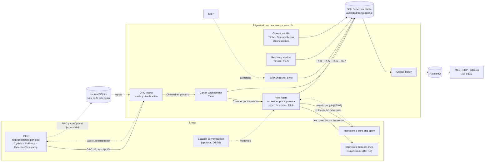
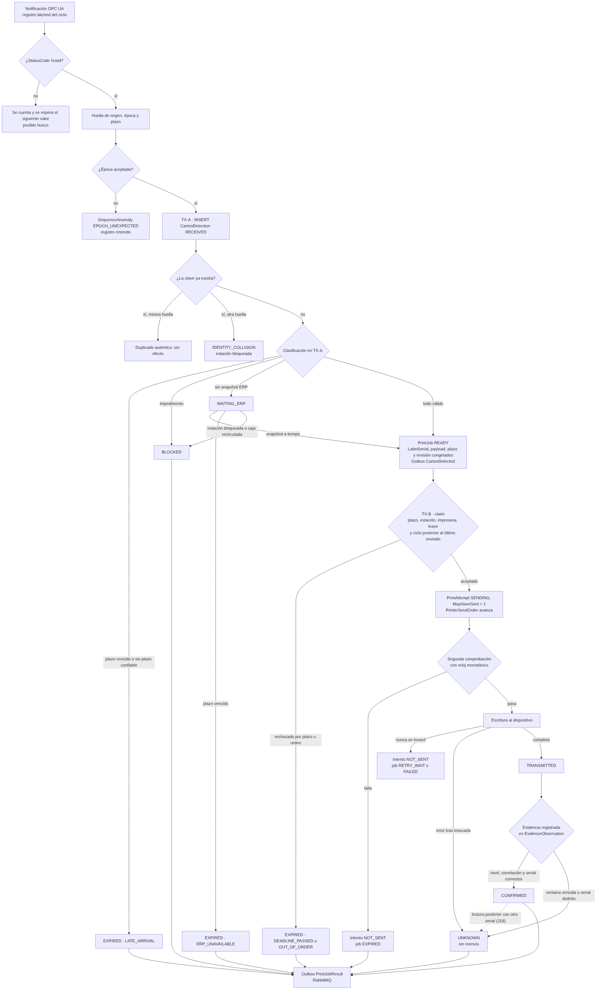
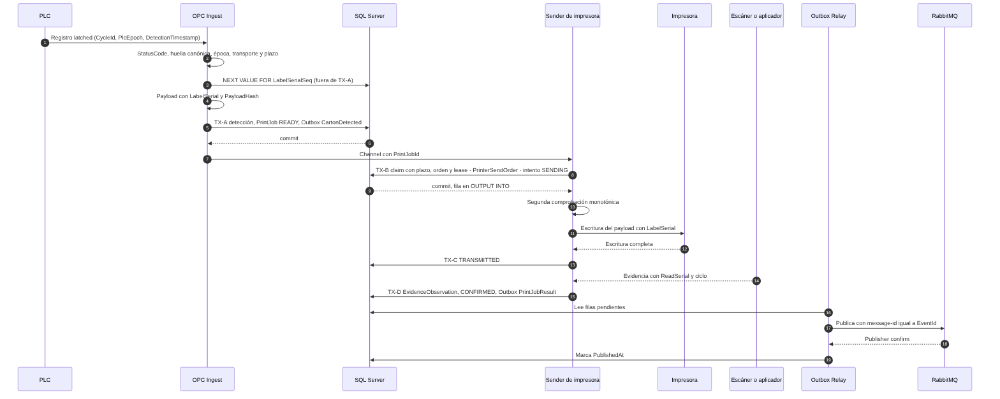
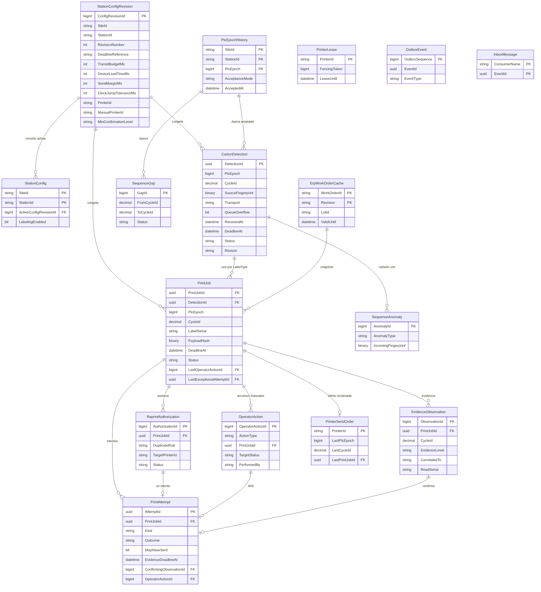
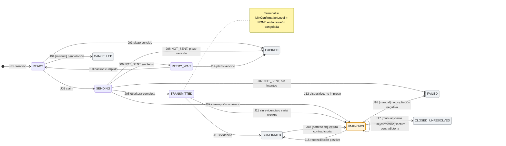
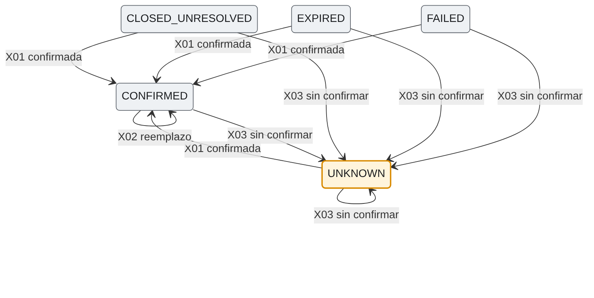
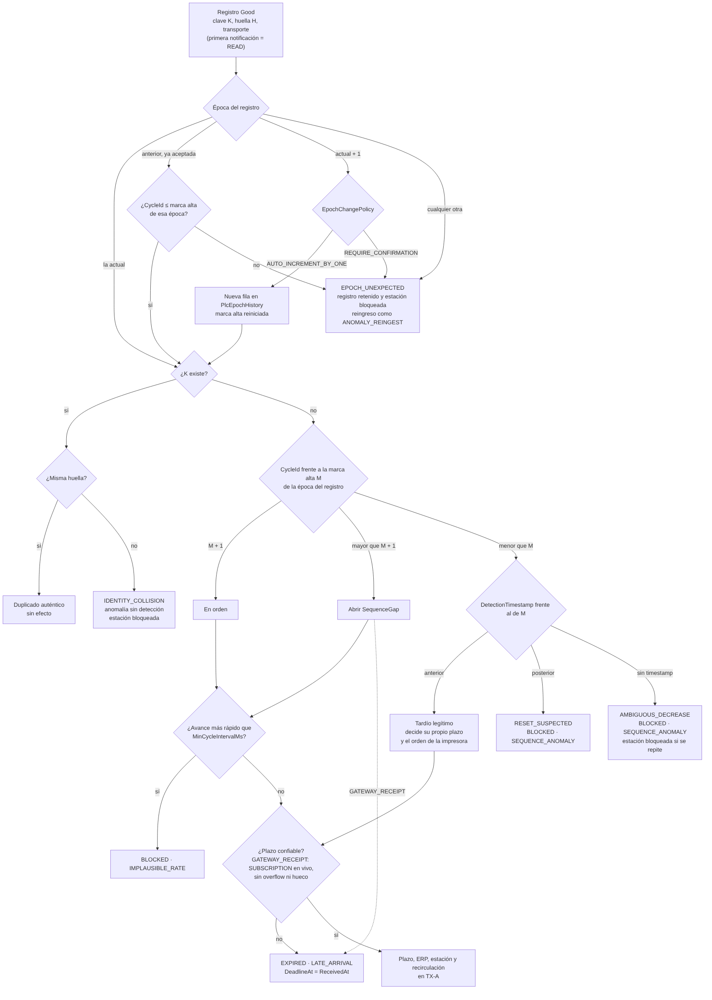
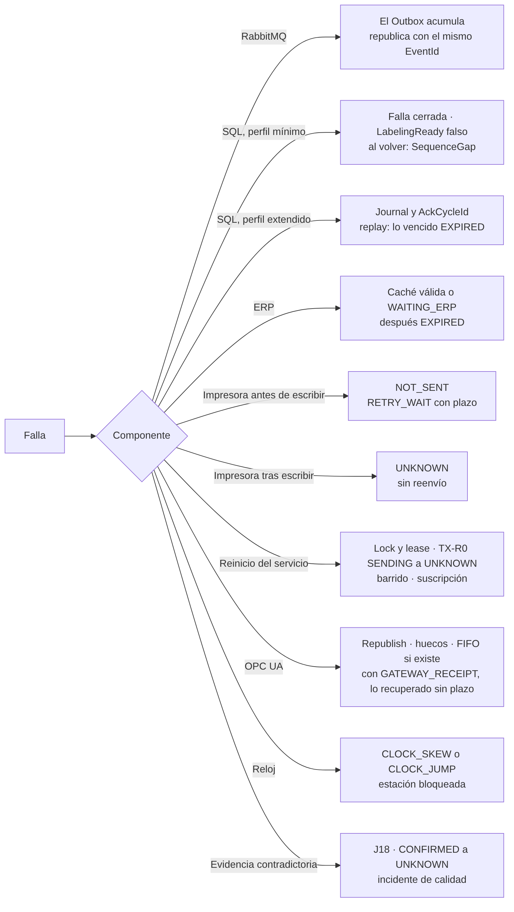
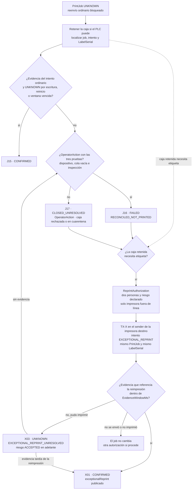

Versión 1.1 · consolidación arquitectónica de la versión 1.0. Es una especificación verificable, no software implementado: ninguna prueba de sistema se ha ejecutado, y todos los tiempos son hipótesis de diseño pendientes de benchmark.

## Índice

<!-- GENERATED:BEGIN toc -->
| Secciones 1 a 13 | Secciones 14 a 25 |
| --- | --- |
| 1. Resumen ejecutivo | 14. Configuración versionada |
| 2. Principio rector y niveles de unicidad | 15. Manejo de fallas y recuperación |
| 3. Arquitectura | 16. Reimpresión excepcional |
| 4. Contrato con el PLC | 17. Rendimiento y latencia |
| 5. Flujo de eventos | 18. Plan de pruebas |
| 6. Modelo de datos | 19. Métricas y alertas |
| 7. Máquina de estados | 20. Matriz de garantías y limitaciones |
| 8. Contratos JSON | 21. Implementación asistida por IA |
| 9. Idempotencia y consistencia | 22. Seguridad y operación de planta |
| 10. Vencimiento y autorización física | 23. Correcciones a las revisiones previas |
| 11. Serial único y evidencia | 24. Decisiones abiertas para OT |
| 12. Identidad de la caja física | 25. Fuentes técnicas |
| 13. Propietario único de impresora |  |
<!-- GENERATED:END toc -->

# 1. Resumen ejecutivo

El diseño garantiza por software, dentro de los límites que declara, que un ciclo del PLC produce como máximo un trabajo de impresión y como máximo una transmisión ordinaria, que ningún envío ordinario empieza después del plazo calculado de su caja y que una impresora de línea nunca recibe un envío ordinario de un ciclo anterior a otro que ya reclamó. Esos límites son explícitos: un solo transmisor por impresora (que en varios hosts exige control físico del canal), relojes dentro de tolerancia, una pausa del proceso que no supere el margen medido (sección 10.2) y triggers habilitados con un rol de aplicación sin permisos de DDL. No garantiza por sí solo que la etiqueta quede en la caja correcta: eso exige integración física (compuerta del PLC, aplicador o escáner correlacionado), y el documento dice exactamente qué cubre cada opción.

| Propiedad | Cómo se obtiene | Clase |
| --- | --- | --- |
| Un evento lógico por ciclo | Identidad `(SiteId, StationId, PlcEpoch, CycleId)`, índice único, huella de origen | Software |
| Un job ordinario por detección | `UQ_PrintJob_DetectionLabel` en la misma transacción que la detección | Software |
| Una transmisión ordinaria potencial por job | Claim condicional, intento persistido antes del I/O, `UX_PrintAttempt_OrdinarySent`, trigger que exige el job en `SENDING` | Software, con un solo transmisor por impresora (G10) |
| Ningún envío ordinario tardío | Plazo congelado que descuenta `DeviceLeadTimeMs`, guarda en el claim, segunda comprobación monotónica, detección de saltos de reloj | Software, con límites documentados (10.2) |
| Orden de envío por impresora | `PrinterSendOrder` en el claim; un job atrasado vence con `OUT_OF_ORDER` | Software |
| Toda acción manual, excepcional o de corrección respaldada, incluido el desbloqueo de una estación | `OperatorAction`, `ReprintAuthorization` y `EvidenceObservation` exigidas por trigger | Software |
| Etiqueta aplicada dentro de la ventana física | Compuerta del PLC o aplicador disparado por el PLC | Integración física |
| Etiqueta correcta en la caja correcta | Escáner que lee `LabelSerial`, correlacionado por ciclo | Integración física |
| Una etiqueta por caja física | `CartonId` confiable leído antes de etiquetar | Integración física |
| Latencia de milisegundos | Un proceso edge, señal en proceso, SQL local | Objetivo de rendimiento |

Ante una impresión incierta el sistema prefiere no reimprimir: `UNKNOWN` bloquea todo reenvío ordinario. La reimpresión existe como procedimiento excepcional, autorizado por dos personas, que declara su riesgo de duplicado.

## 1.1 Qué cambió frente a la versión 1.0

| Hallazgo | Problema en 1.0 | Decisión en 1.1 | ADR |
| --- | --- | --- | --- |
| H1 | No había vencimiento: un job tardío imprimía sobre otra caja | Plazo por caja, guarda en el claim, segunda comprobación, estado `EXPIRED` | 0006 |
| H2 | Estados distintos en diagramas, DDL, contratos y runbook | `contracts/state-machine.json` como única fuente, aplicada por triggers; `TRANSMITTED` y `CLOSED_UNRESOLVED` nuevos | 0014, 0003 |
| H3 | Evidencia sin serial; el schema aceptaba `CONFIRMED` sin evidencia | `LabelSerial` único, niveles `PRINTED`, `APPLIED`, `VERIFIED`, reglas condicionales | 0008 |
| H4 | Un reinicio del contador se tomaba como duplicado, sin alarma | `PlcEpoch` en la identidad; huella de origen; clasificación de eventos tardíos, huecos y colisiones | 0007 |
| H5 | Tres capas durables y cinco procesos; SLO hasta `READY` | Perfil mínimo de un proceso; perfil extendido justificado por requisito; `SequenceGap` | 0009, 0005 |
| H6 | Dueño único de impresora sin mecanismo | Sender único por impresora; lock de sistema operativo; límites del lease explícitos | 0010 |
| H7 | ADR con contexto repetido, PNG distinto de su Mermaid, idioma mezclado | ADR reescritos, Mermaid como única fuente, verificador del paquete | todos |
| H8 | Se confundía una etiqueta por ciclo con una por caja física | Dos garantías separadas; modo `CARTON_ID_REQUIRED` | 0013 |
| H9 | Parámetros sin versión | Revisiones inmutables; plazo y revisión congelados por job | 0011 |
| H10 | Garantías sin clasificar | Matriz de garantías y limitaciones | — |
| Revisión independiente | 30 defectos en el borrador de esta versión: triggers que fallaban con 0 filas, claim con `OUTPUT` inválido, plazo fabricado para registros tardíos, envío fuera de orden, acciones manuales sin registro, entre otros | Corregidos o acotados uno por uno; una segunda revisión sobre las correcciones encontró 14 más, también resueltos (sección 23.1) | 0006, 0010, 0012, 0014, 0015 |

Las dos revisiones previas no se aceptaron como autoridad. Las correcciones que esta versión hace a cada una están en la sección 23; los hallazgos de la revisión independiente del borrador y su resolución, en la 23.1.

# 2. Principio rector y niveles de unicidad

Una transacción SQL correcta no implica una operación física correcta. El diseño separa seis niveles y nunca usa uno como prueba de otro:

| Nivel | Qué se garantiza | Mecanismo | Lo que NO prueba |
| --- | --- | --- | --- |
| Evento | Un `eventId` por hecho, estable en reenvíos | UUIDv5 determinista, `UQ_OutboxEvent_EventId`, Inbox | Que el hecho físico ocurrió una vez |
| Detección | Una detección por ciclo del PLC | `UQ_CartonDetection_Identity` y huella de origen | Que el ciclo corresponda a una caja distinta |
| Trabajo | Un PrintJob ordinario por detección y tipo | `UQ_PrintJob_DetectionLabel` | Que se transmitió una sola vez |
| Transmisión autorizada | Como máximo un intento ordinario que pudo transmitir | Claim, `UX_PrintAttempt_OrdinarySent`, `UX_PrintAttempt_JobOpen`, `TR_PrintAttempt_Guard`, triggers | Que la impresora imprimió |
| Impresión física | Que salió una etiqueta del job | Evidencia `PRINTED` correlacionada con el job | Que se aplicó a una caja |
| Aplicación y verificación | Que la etiqueta correcta quedó en la caja del ciclo | `APPLIED` correlacionado con el ciclo; `VERIFIED` con `ReadSerial = LabelSerial` | Nada más allá de la correlación disponible |

# 3. Arquitectura

{ width=100% }

El perfil mínimo es un único proceso edge (`src/EdgeHost`) en la red de la línea, con SQL Server en planta como autoridad transaccional. Los módulos son bibliotecas separadas que se alojan como hosted services en el mismo proceso:

| Módulo | Responsabilidad | Transacciones |
| --- | --- | --- |
| OPC Ingest | Suscripción OPC UA, validación de calidad, huella de origen, clasificación de secuencia, plazo | TX-A |
| Carton Orchestrator | Resolución de snapshot ERP, creación del job, recirculación | TX-A, TX-E |
| ERP Snapshot Sync | Mantiene `ErpWorkOrderCache`; nunca se consulta al ERP por caja | — |
| Print Agent | Un sender por impresora: claim con orden de envío, segunda comprobación, escritura, evidencia, ejecución de reimpresiones autorizadas | TX-B, TX-C, TX-D, TX-X |
| Outbox Relay | Publica el Outbox en RabbitMQ con publisher confirms | — |
| Recovery Worker | Arranque, barrido de vencimientos por estación, ventanas de evidencia, huecos, autorizaciones vencidas, vigilancia de saltos de reloj | TX-R0, TX-S |
| Operations API | Acciones manuales auditadas en `OperatorAction`: cancelación, reconciliación, cierre; solicitud y aprobación de reimpresiones, que ejecuta el sender de la impresora destino | TX-M |

La señal entre ingesta y sender usa `System.Threading.Channels` dentro del proceso: no hay broker ni polling en la ruta crítica. RabbitMQ distribuye `CartonDetected` y `PrintJobResult` a MES, ERP y tableros, pero si cae, la impresión sigue igual.

## 3.1 Perfiles operacionales

| Componente | Perfil mínimo | Perfil extendido | Requisito que lo justifica |
| --- | --- | --- | --- |
| EdgeHost, SQL Server, OPC UA, adaptador de impresora, Outbox, caché ERP | Sí | Sí | Flujo base |
| FIFO de ciclos en el PLC | No | Sí | Recuperar los datos de cada ciclo tras una desconexión (OT-14) |
| `AckCycleId` al PLC | No | Sí | El PLC debe saber qué ciclos quedaron registrados (OT-14) |
| Journal SQLite local | No | Sí | Conservar ciclos con ACK mientras SQL no está disponible (OT-13, OT-14) |
| Ante caída de SQL | Falla cerrada; el PLC retiene, desvía o detiene | El journal captura; no se imprime | Historia completa exigida o no |

No se eliminan mecanismos de durabilidad por reducir tecnologías: el perfil extendido se activa cuando OT exige la historia completa de ciclos y acepta modificar el PLC. Aun en ese perfil, todo lo que se reprocesa después del plazo queda `EXPIRED` y nunca se imprime.

# 4. Contrato con el PLC

| Tag OPC (registro latched por ciclo) | Tipo | Obligatorio | Semántica |
| --- | --- | --- | --- |
| `CycleId` | UInt64 | Sí | Avanza una vez por caja; persistente |
| `PlcEpoch` | UInt32 | Recomendado | Cambia cuando el contador se reinicia; persistente (OT-04) |
| `DetectionTimestamp` | DateTime | Recomendado | Instante del flanco, escrito por el PLC como dato |
| `WorkOrderId` | String | Sí | Orden activa congelada al detectar la caja |
| `CartonId` | String | Opcional | Identidad física si existe (OT-05) |
| `LabelingReady` (escrito por el servicio) | Boolean | Sí | Latido de etiquetadora lista; el PLC actúa si cae |
| `PrintWindowCycleId` | UInt64 | Opcional | Ciclo que está en la zona de impresión (compuerta `PLC_WINDOW_TAG`) |
| `PendingCycles` y `AckCycleId` | Registro | Perfil extendido | FIFO de ciclos y acuse de captura durable |

El PLC fija todos los campos del ciclo en una estructura latched. Leer tags independientes no da una instantánea coherente; si los campos no corresponden al mismo ciclo, la detección queda `BLOCKED` con `INCOHERENT_SNAPSHOT`. Los intervalos de muestreo y publicación de OPC UA se negocian con el servidor; 10 y 20 ms son solicitudes, no garantías. El EdgeHost registra cómo llegó cada registro (`Transport`: notificación en vivo, Republish, FIFO, lectura tras reconexión, replay o reingreso) y el bit Overflow del StatusCode (`QueueOverflow`), porque con `GATEWAY_RECEIPT` solo una notificación en vivo y sin overflow tiene una latencia acotada (sección 10.1).

# 5. Flujo de eventos

{ width=78% }

{ width=100% }

Camino feliz:

1. El PLC fija el registro del ciclo; OPC UA notifica al EdgeHost.
2. TX-A inserta la detección `RECEIVED` con su huella. Si la clave ya existía, se clasifica en otra transacción (sección 9.2) y el flujo termina ahí.
3. En la misma TX-A: snapshot ERP válido, plazo vigente y estación habilitada, entonces se crea el job `READY` con `LabelSerial` (obtenido antes de TX-A), payload, hash, plazo y revisión congelados, se escribe el Outbox `CartonDetected` y la detección pasa a `JOB_CREATED`.
4. El sender de la impresora recibe la señal y ejecuta TX-B: claim condicional que también exige que el ciclo sea posterior al último reclamado por esa impresora, avance de `PrinterSendOrder` e intento `SENDING` con `MayHaveSent = 1`, confirmados antes de abrir el socket.
5. Fuera de toda transacción, la segunda comprobación con reloj monotónico decide si todavía puede escribir.
6. Escribe el payload. TX-C pasa intento y job a `TRANSMITTED`.
7. Llega la evidencia (TX-D): se registra en `EvidenceObservation` y, si cumple nivel, correlación y serial (lo exige `TR_PrintAttempt_Guard`), intento y job pasan a `CONFIRMED` y el Outbox recibe `PrintJobResult`.
8. El Outbox Relay publica; los consumidores deduplican con `InboxMessage`.

Transacciones del diseño: TX-A registro, TX-B claim, TX-C resultado de la escritura, TX-D evidencia, TX-E llegada de snapshot ERP, TX-S barrido, TX-M acción manual, TX-X reimpresión excepcional, TX-R0 recuperación al arrancar. Las sentencias de referencia están en `database/sqlserver_operations_reference.sql`.

# 6. Modelo de datos

{ width=100% }

| Tabla | Responsabilidad | Restricciones clave |
| --- | --- | --- |
| `StationConfigRevision` | Parámetros inmutables por revisión | `UQ_StationConfigRevision_Number`; trigger que impide UPDATE y DELETE |
| `StationConfig` | Revisión activa y estado operativo (`LabelingEnabled`) | FK compuesta a la revisión de la misma estación; no se borra; desbloquear exige una `OperatorAction` (`TR_StationConfig_Guard`) |
| `PlcEpochHistory` | Épocas aceptadas y cómo se aceptaron | PK `(SiteId, StationId, PlcEpoch)`; inmutable; una aceptación manual exige `OperatorAction` `CONFIRM_EPOCH` |
| `CartonDetection` | Ciclos observados o recuperados con datos reales | `UQ_CartonDetection_Identity`, FK a la época aceptada |
| `SequenceAnomaly` | Colisiones, reinicios sospechados, épocas inesperadas | Registro completo retenido en JSON |
| `SequenceGap` | Rangos de ciclos sin datos | Conteo, nunca detecciones inventadas |
| `ErpWorkOrderCache` | Snapshots ERP por orden y revisión | PK `(WorkOrderId, Revision)` |
| `PrintJob` | Trabajo congelado | `UQ_PrintJob_DetectionLabel`, `UQ_PrintJob_LabelSerial`, trigger de inmutabilidad |
| `PrintAttempt` | Cada transmisión, ordinaria o excepcional | `UX_PrintAttempt_PrinterInFlight`, `UX_PrintAttempt_JobOpen`, `UX_PrintAttempt_OrdinarySent`, FK compuesta a su autorización, `TR_PrintAttempt_Guard` |
| `ReprintAuthorization` | Autorización de reimpresión excepcional | Dos personas, riesgo declarado, motivo ligado al estado previo, una vigente por job, `TR_ReprintAuthorization_Guard` |
| `OperatorAction` | Registro de cada acción manual (solo inserción) | Tres pruebas obligatorias en la reconciliación negativa; exigida por los triggers de estado |
| `EvidenceObservation` | Toda evidencia recibida, confirme o no (solo inserción) | Nivel, correlación y serial coherentes por `CHECK` |
| `PrinterSendOrder` | Último ciclo reclamado por cada impresora de línea | Leída con `UPDLOCK` en el claim; no retrocede (`TR_PrinterSendOrder_Monotonic`) |
| `PrinterLease` | Dueño lógico de la impresora | Fencing token; no es control físico |
| `OutboxEvent`, `InboxMessage` | Publicación y consumo idempotentes | `UQ_OutboxEvent_EventId`, PK `(ConsumerName, EventId)` |
| `AllowedTransition` | Transiciones permitidas, generadas desde la máquina de estados | Consultada por los triggers `TR_*_StateMachine` |

Dónde se valida cada regla:

| Regla | Dónde |
| --- | --- |
| Identidad, unicidad, valores de estado y motivo, combinaciones dentro de la fila | `UNIQUE`, `CHECK` |
| Transiciones permitidas y el respaldo que exige cada modo | Triggers `TR_*_StateMachine` contra `AllowedTransition` (tabla de la sección 7) |
| Inmutabilidad de lo congelado y campos que se fijan una sola vez | Triggers `TR_*_Immutable` |
| Quién abre un intento; con qué evidencia se confirma; `ReadSerial = LabelSerial`; nivel ≥ mínimo | `TR_PrintAttempt_Guard` |
| Estado previo real, impresora destino y riesgo `NONE_PROVEN` de una autorización | `TR_ReprintAuthorization_Guard` y `TR_PrintAttempt_Guard` |
| Estados sin etiqueta (`READY`, `RETRY_WAIT`, `FAILED`, `EXPIRED`, `CANCELLED`) solo si ningún intento pudo imprimir | `TR_PrintJob_StateMachine` |
| Orden de envío por impresora | Claim (TX-B) con `UPDLOCK` sobre `PrinterSendOrder` |
| Recirculación por `CartonId` | TX-A y TX-E con `UPDLOCK, HOLDLOCK` sobre `IX_PrintJob_Carton` e `IX_CartonDetection_Carton` |
| Que un intento `NOT_SENT` nunca invocó la escritura | Código (I02): SQL no puede probarlo porque `WriteStartedAt` se persiste después de escribir |
| Plazo solo para entregas en vivo con `GATEWAY_RECEIPT`; sin plazo para `PLC_TIMESTAMP` sin `DetectionTimestamp` | `CK_CartonDetection_GatewayLive`, `CK_CartonDetection_PlcTimestamp` y código de TX-A (primera notificación y huecos) |
| `ReadSerial = LabelSerial` sin variaciones de mayúsculas ni espacios | Intercalación `Latin1_General_100_BIN2` en ambas columnas |

Permisos: el rol de la aplicación no tiene permisos de DDL ni de escritura sobre `AllowedTransition`, que solo modifica la migración que ejecuta `database/sqlserver_state_transitions.sql`; un rol con esos permisos podría saltarse los triggers. Convenciones del DDL que el verificador comprueba: opciones `SET` al inicio (`ANSI_NULLS` y `QUOTED_IDENTIFIER` en `ON`, necesarias para los índices filtrados); todo trigger `AFTER UPDATE` o `DELETE` empieza con la guarda de 0 filas, porque SQL Server lo dispara aunque la sentencia no afecte filas; ningún `OUTPUT` sin `INTO` sobre una tabla con triggers (Msg 334). Las transacciones de referencia usan `OUTPUT ... INTO` una variable de tabla para saber si una sentencia afectó filas.

El serial se obtiene de `LabelSerialSeq` antes de TX-A, fuera de la transacción; con él se arma el payload y se calcula `PayloadHash`, y después se inserta el job. Los valores son únicos pero no consecutivos: un duplicado o un rollback consumen el valor y el CACHE puede perderlos en un apagado abrupto.

# 7. Máquina de estados

La fuente es `contracts/state-machine.json`. Los diagramas, estas tablas y `database/sqlserver_state_transitions.sql` se generan desde ella, y `tools/verify_package.py` comprueba que el DDL, los schemas, los ejemplos y las pruebas coinciden.

{ width=100% }

{ width=70% }

Reglas que la máquina hace explícitas:

- `SENDING` se persiste antes de cualquier operación que pueda imprimir. Un proceso que muere entre ese commit y la escritura deja un falso `UNKNOWN`: costo aceptado para no duplicar.
- `NOT_SENT` solo si la escritura nunca se invocó. Un timeout después de invocarla no prueba nada: lleva a `UNKNOWN`.
- `TRANSMITTED` significa bytes entregados al transporte, no etiqueta impresa.
- `UNKNOWN` tiene cuatro salidas separadas: reconciliación positiva (J15), reconciliación negativa con prueba de ausencia (J16), cierre operativo sin resolver (J17) y reimpresión excepcional verificada (X01). Una reimpresión sin confirmar lo mantiene en `UNKNOWN` (X03) con nueva versión del resultado.
- J15 solo procede si la incertidumbre vino de una escritura interrumpida, un reinicio o una ventana de evidencia vencida. Después de una lectura contradictoria (`SERIAL_MISMATCH`) no hay reconciliación automática.
- Ningún estado terminal tiene salidas ordinarias. Solo salen de ellos las transiciones de procedimiento excepcional (X01, X02, X03) y la corrección J18, que solo reduce certeza (`CONFIRMED → UNKNOWN`, o cambia el motivo de un `UNKNOWN` a `SERIAL_MISMATCH`).
- `TR_PrintJob_StateMachine` evalúa todo cambio de estado, de `Reason`, de `ConfirmedByExceptionalReprint` y de los punteros de respaldo: un `UPDATE` que solo cambie el motivo para habilitar otra transición se rechaza.
- Un envío atrasado respecto de la impresora vence con `OUT_OF_ORDER` (J03, J14) aunque su plazo siga vigente.

Cada modo exige en SQL un respaldo distinto, no solo una fila en `AllowedTransition`:

| Modo | `Kind` sembrado | Respaldo que exige el trigger |
| --- | --- | --- |
| automática | `AUTO` | Ninguno adicional; confirmar exige un intento ordinario `CONFIRMED` |
| manual | `MANUAL` | Una `OperatorAction` nueva (identificador mayor que la anterior) del mismo job con `TargetStatus` igual al destino |
| excepcional | `EXCEPTION` | `SESSION_CONTEXT` `EXCEPTION` y el intento `EXCEPTIONAL_REPRINT` más reciente del job, apuntado por `LastExceptionalAttemptId`, cuyo resultado es el destino |
| corrección | `CORRECTION` | `SESSION_CONTEXT` `CORRECTION` y una `EvidenceObservation` `VERIFIED` del ciclo del job con otro serial |

La marca de sesión declara la intención y se limpia en el `CATCH`; la guarda real son los datos. Una sesión que fije la marca sin un intento excepcional o una lectura contradictoria no puede mover el job.

<!-- GENERATED:BEGIN state-tables -->
**CartonDetection** (`dbo.CartonDetection.Status`)

| Estado | Terminal | Significado |
| --- | --- | --- |
| `RECEIVED` | No | Ciclo observado o recuperado, registrado con su identidad. Aún no se decide si genera job. |
| `WAITING_ERP` | No | No hay snapshot ERP válido para la orden; el plazo de la caja sigue vigente. |
| `JOB_CREATED` | Sí | Existe el PrintJob ordinario de esta detección. |
| `BLOCKED` | Sí | No se crea job: datos incoherentes, anomalía de secuencia, estación deshabilitada, rebote o caja recirculada. |
| `EXPIRED` | Sí | El plazo venció antes de poder crear el job. Nunca se imprime. |

| ID | Desde | Hacia | Modo | Disparador | Guarda |
| --- | --- | --- | --- | --- | --- |
| D01 | creación | `RECEIVED` | automática | INSERT de la identidad (SiteId, StationId, PlcEpoch, CycleId) con su huella de origen. | Registro OPC con StatusCode Good; PlcEpoch aceptada y CycleId dentro de lo admitido para esa época (ADR 0007); la clave no existía. |
| D02 | `RECEIVED` | `JOB_CREATED` | automática | Clasificación en la misma transacción del registro. | Snapshot ERP válido para WorkOrderId; plazo efectivo vigente con margen; estación habilitada; sin caja recirculada. |
| D03 | `RECEIVED` | `WAITING_ERP` | automática | Clasificación sin snapshot ERP válido. | Plazo vigente; estación habilitada. |
| D04 | `RECEIVED` | `EXPIRED` | automática | Clasificación de un registro que llega con el plazo vencido o que no tiene plazo confiable: evento tardío, Republish, FIFO, lectura tras reconexión, replay o reingreso de anomalía. | Plazo efectivo vencido al registrar; o referencia GATEWAY_RECEIPT y el registro no llegó en vivo (Transport distinto de SUBSCRIPTION, overflow, primera notificación de un monitored item creado o transferido, que se registra como READ) o abre un hueco de secuencia. |
| D05 | `RECEIVED` | `BLOCKED` | automática | Clasificación que detecta un impedimento. | INCOHERENT_SNAPSHOT (incluido PLC_TIMESTAMP sin DetectionTimestamp, registrado con DeadlineAt = ReceivedAt), IMPLAUSIBLE_RATE, SEQUENCE_ANOMALY (reinicio sospechado o disminución ambigua), STATION_DISABLED o RECIRCULATED_CARTON. |
| D06 | `WAITING_ERP` | `JOB_CREATED` | automática | Llega un snapshot ERP válido. | Plazo efectivo vigente con margen; estación habilitada; sin caja recirculada (se repite la validación de TX-A). |
| D07 | `WAITING_ERP` | `EXPIRED` | automática | Barrido de vencimientos o snapshot que llega tarde. | Plazo efectivo vencido. |
| D08 | `WAITING_ERP` | `BLOCKED` | automática | Llega el snapshot con la estación bloqueada, o la revalidación detecta caja recirculada. | Plazo vigente; estación deshabilitada o recirculación detectada. |

Transiciones prohibidas: `EXPIRED → JOB_CREATED` (Un job creado después del plazo imprimiría sobre otra caja.); `BLOCKED → JOB_CREATED` (El bloqueo se resuelve en la estación, no reabriendo detecciones; la caja sigue la política de rechazo.).

**PrintJob** (`dbo.PrintJob.Status`)

| Estado | Terminal | Significado |
| --- | --- | --- |
| `READY` | No | Job completo y congelado. Ningún intento abierto y ningún intento con MayHaveSent = 1. |
| `SENDING` | No | Intento ordinario reclamado y persistido antes de cualquier I/O. Se asume que pudo empezar a transmitir. |
| `TRANSMITTED` | Si MinConfirmationLevel = NONE en la revisión congelada | La escritura terminó: el transporte aceptó todos los bytes. Puede o no haberse impreso. Espera evidencia durante EvidenceWindowMs. |
| `RETRY_WAIT` | No | El último intento quedó NOT_SENT comprobado; espera el backoff con el plazo vigente. |
| `CONFIRMED` | Sí | Evidencia que cumple el MinConfirmationLevel congelado y su regla de correlación. Una evidencia posterior contradictoria lo corrige a UNKNOWN (J18). |
| `UNKNOWN` | No | Pudo haberse impreso y no hay evidencia concluyente. Bloquea todo reenvío ordinario. |
| `FAILED` | Sí | Se sabe que no existe etiqueta de este job: intentos agotados sin transmisión, cancelación confirmada por el dispositivo o reconciliación negativa con sus tres pruebas. |
| `EXPIRED` | Sí | Sin ninguna transmisión, venció el plazo o la impresora ya envió un ciclo posterior (OUT_OF_ORDER): todos los intentos quedaron NOT_SENT o no hubo intentos. |
| `CANCELLED` | Sí | Anulado por una persona autorizada antes de cualquier transmisión. |
| `CLOSED_UNRESOLVED` | Sí | Cierre operativo de un UNKNOWN sin resolver la incertidumbre; la caja quedó rechazada o en cuarentena. |

| ID | Desde | Hacia | Modo | Disparador | Guarda |
| --- | --- | --- | --- | --- | --- |
| J01 | creación | `READY` | automática | Detección D02 o D06. | UNIQUE (DetectionId, LabelType); LabelSerial de la SEQUENCE; payload y hash calculados. |
| J02 | `READY` | `SENDING` | automática | Claim del sender único de la impresora. | Status = READY; @EdgeNowUtc < plazo efectivo − SendMarginMs efectivo; estación habilitada; PrinterId del job igual al de la revisión activa; lease vigente; ningún otro intento SENDING en la impresora; (PlcEpoch, CycleId) del job mayor que el último enviado por la impresora (PrinterSendOrder). |
| J03 | `READY` | `EXPIRED` | automática | Barrido o claim rechazado por plazo o por orden de envío. | @EdgeNowUtc ≥ plazo efectivo − SendMarginMs efectivo (DEADLINE_PASSED), o la impresora ya envió un ciclo posterior (OUT_OF_ORDER). |
| J04 | `READY` | `CANCELLED` | manual | Cancelación solicitada por una persona autorizada. | Ningún intento del job con MayHaveSent = 1; OperatorAction CANCEL_JOB registrada en la misma transacción. |
| J05 | `SENDING` | `TRANSMITTED` | automática | La escritura terminó sin error de transporte. | Intento en SENDING del mismo lease. |
| J06 | `SENDING` | `RETRY_WAIT` | automática | Intento NOT_SENT comprobado: fallo de conexión antes de escribir, o la segunda comprobación rechazó por compuerta o estación bloqueada con el plazo vigente. | AutoAttemptCount < MaxAutoAttempts; plazo efectivo vigente. Un rechazo por compuerta o estación no consume intento (AutoAttemptCount se restituye). |
| J07 | `SENDING` | `FAILED` | automática | Intento NOT_SENT por fallo de conexión antes de escribir. | AutoAttemptCount ≥ MaxAutoAttempts; plazo efectivo vigente. |
| J08 | `SENDING` | `EXPIRED` | automática | Intento NOT_SENT con el plazo efectivo vencido, incluida la segunda comprobación previa al envío. | Plazo efectivo vencido. |
| J09 | `SENDING` | `UNKNOWN` | automática | Escritura interrumpida o timeout después de invocarla; o el arranque encuentra el job en SENDING. | Ninguna; es la salida conservadora. |
| J10 | `TRANSMITTED` | `CONFIRMED` | automática | Llega evidencia para el intento. | MinConfirmationLevel congelado distinto de NONE (el trigger lo exige); nivel de la evidencia ≥ mínimo; correlación según el nivel; si es VERIFIED, ReadSerial = LabelSerial. El trigger exige un intento ORDINARY del job en CONFIRMED. |
| J11 | `TRANSMITTED` | `UNKNOWN` | automática | Vence EvidenceWindowMs sin evidencia suficiente, o la evidencia contradice al job. | MinConfirmationLevel congelado distinto de NONE (el trigger lo exige). |
| J12 | `TRANSMITTED` | `FAILED` | automática | El dispositivo reporta que este job específico no se imprimió. | MinConfirmationLevel congelado distinto de NONE (el trigger lo exige); el dispositivo confirma, para este job específico, que lo canceló o descartó y que ya no está en su cola (OT-07). Un reporte de 'no impreso' sin esa confirmación no basta. |
| J13 | `RETRY_WAIT` | `READY` | automática | Se cumple NextAttemptAt. | Plazo efectivo vigente con margen y la impresora no ha enviado un ciclo posterior. |
| J14 | `RETRY_WAIT` | `EXPIRED` | automática | Barrido, o la impresora envió un ciclo posterior. | Plazo efectivo vencido (DEADLINE_PASSED) o ciclo posterior ya enviado (OUT_OF_ORDER). |
| J15 | `UNKNOWN` | `CONFIRMED` | automática | Reconciliación positiva: evidencia tardía del intento original (lectura del serial, inspección con lectura). | Misma regla de nivel y correlación que J10; solo si el UNKNOWN vino de WRITE_INTERRUPTED, RESTART_DURING_SEND o EVIDENCE_WINDOW_ELAPSED; el trigger exige un intento ORDINARY del job en CONFIRMED. |
| J16 | `UNKNOWN` | `FAILED` | manual | Reconciliación negativa. | OperatorAction RECONCILE_NEGATIVE con las tres pruebas: el dispositivo confirma que el job no se imprimió, su cola quedó vacía o cancelada, y la inspección de la caja retenida no encuentra la etiqueta. |
| J17 | `UNKNOWN` | `CLOSED_UNRESOLVED` | manual | Cierre operativo sin resolver la incertidumbre. | OperatorAction CLOSE_UNRESOLVED con la caja rechazada o en cuarentena. |
| J18 | `CONFIRMED`, `UNKNOWN` | `UNKNOWN` | corrección | Llega una lectura VERIFIED correlacionada con el ciclo cuyo serial no es el LabelSerial del job, con el job ya confirmado o en UNKNOWN por otra causa. | SESSION_CONTEXT TransitionKind = CORRECTION; EvidenceObservation VERIFIED del ciclo del job con ReadSerial distinto de LabelSerial, recibida en o después del ClaimedAt del último intento del job y con ObservationId mayor que el ConfirmingObservationId de cualquier intento del job (el trigger lo exige, ADR 0016). Desde UNKNOWN cambian Reason y resultVersion, no el estado; después no hay reconciliación automática. |
| X01 | `UNKNOWN`, `FAILED`, `EXPIRED`, `CLOSED_UNRESOLVED` | `CONFIRMED` | excepcional | Un intento EXCEPTIONAL_REPRINT quedó CONFIRMED. | SESSION_CONTEXT TransitionKind = EXCEPTION; el UPDATE fija LastExceptionalAttemptId al intento EXCEPTIONAL_REPRINT más reciente del job, en CONFIRMED (el trigger lo exige), ligado a una ReprintAuthorization EXECUTED; evidencia de nivel ≥ PRINTED (o el congelado si es mayor) que referencia a ese intento y llegó después de su claim. |
| X02 | `CONFIRMED` | `CONFIRMED` | excepcional | Reimpresión por etiqueta dañada quedó CONFIRMED. | Igual que X01 con una autorización LABEL_DAMAGED: el retiro de la etiqueta original se registró antes de ejecutar (OriginalLabelRemovedBy, exigido por TR_PrintAttempt_Guard) y la etiqueta de reemplazo quedó confirmada con evidencia de ese intento. |
| X03 | `UNKNOWN`, `FAILED`, `EXPIRED`, `CLOSED_UNRESOLVED`, `CONFIRMED` | `UNKNOWN` | excepcional | Un intento EXCEPTIONAL_REPRINT que pudo transmitir terminó UNKNOWN: error después de invocar la escritura, reinicio, evidencia contradictoria o ventana de evidencia vencida. | SESSION_CONTEXT TransitionKind = EXCEPTION; en la misma transacción que deja el intento en UNKNOWN; el UPDATE fija LastExceptionalAttemptId al intento EXCEPTIONAL_REPRINT más reciente del job, en UNKNOWN (el trigger lo exige). Desde UNKNOWN el estado no cambia, pero sí Reason y resultVersion. |

Transiciones prohibidas: `SENDING → READY` (Un intento que pudo transmitir no vuelve a la cola: rompería la garantía de no duplicación.); `SENDING → CONFIRMED` (Confirmar exige que la escritura haya terminado (TRANSMITTED) y evidencia.); `TRANSMITTED → READY` (Los bytes ya se entregaron al dispositivo.); `TRANSMITTED → RETRY_WAIT` (Los bytes ya se entregaron al dispositivo.); `UNKNOWN → READY` (UNKNOWN significa que pudo imprimirse.); `UNKNOWN → SENDING` (Una autorización no prueba ausencia de impresión; la reimpresión es un intento excepcional, no una transición.); `UNKNOWN → RETRY_WAIT` (UNKNOWN significa que pudo imprimirse.); `EXPIRED → READY` (La caja ya salió de la ventana física.); `FAILED → READY` (Los estados terminales no reabren el flujo ordinario.); `RETRY_WAIT → SENDING` (Todo envío pasa por READY y por las guardas del claim.).

**PrintAttempt** (`dbo.PrintAttempt.Outcome`)

| Estado | Terminal | Significado |
| --- | --- | --- |
| `SENDING` | No | Intento abierto con MayHaveSent = 1. Persistido antes de cualquier I/O. |
| `NOT_SENT` | Sí | Comprobado: nunca se invocó la escritura (fallo de conexión o segunda comprobación previa). MayHaveSent = 0. |
| `TRANSMITTED` | No | La escritura terminó; el transporte aceptó todos los bytes. |
| `UNKNOWN` | No (puede quedar abierto) | Escritura interrumpida o resultado indeterminado. Puede quedar así si el job se cierra sin resolver. |
| `CONFIRMED` | Sí | Evidencia suficiente para este intento. |
| `NOT_PRINTED` | Sí | El dispositivo o la reconciliación demostró que este intento no imprimió. |

| ID | Desde | Hacia | Modo | Disparador | Guarda |
| --- | --- | --- | --- | --- | --- |
| A01 | creación | `SENDING` | automática | Claim ordinario (J02) o ejecución de una reimpresión excepcional autorizada. | TR_PrintAttempt_Guard: ORDINARY exige el job en SENDING, PrinterId = PrintJob.PrinterId y AttemptPayloadHash = PayloadHash; EXCEPTIONAL_REPRINT exige su ReprintAuthorization del mismo job en EXECUTED, el job en PriorJobStatus, PrinterId = TargetPrinterId y SESSION_CONTEXT EXCEPTION. Además UX_PrintAttempt_PrinterInFlight, UX_PrintAttempt_JobOpen, UX_PrintAttempt_OrdinarySent y lease vigente. |
| A02 | `SENDING` | `NOT_SENT` | automática | Fallo de conexión antes de escribir, o la segunda comprobación previa al envío rechaza. | Regla de código: el sender nunca invocó la escritura (no llamó a write sobre el socket). SQL no puede comprobarlo: WriteStartedAt solo se persiste después de escribir. |
| A03 | `SENDING` | `TRANSMITTED` | automática | La escritura terminó. | WriteCompletedAt registrado. |
| A04 | `SENDING` | `UNKNOWN` | automática | Error o timeout después de invocar la escritura, o arranque que encuentra el intento abierto. | Ninguna. |
| A05 | `TRANSMITTED` | `CONFIRMED` | automática | Evidencia suficiente. | Regla de nivel y correlación (TR_PrintAttempt_Guard); la EvidenceObservation llegó después del claim del intento, confirma un solo intento y, si el intento es EXCEPTIONAL_REPRINT, lo referencia. |
| A06 | `TRANSMITTED` | `UNKNOWN` | automática | Vence EvidenceDeadlineAt del intento (ordinario o excepcional) o la evidencia contradice. | Nivel mínimo distinto de NONE; EvidenceDeadlineAt del intento vencida, o EvidenceObservation contradictoria. |
| A07 | `TRANSMITTED` | `NOT_PRINTED` | automática | El dispositivo reporta no impresión del job. | Igual que J12: el dispositivo confirma para este job que lo canceló o descartó y que ya no está en su cola (OT-07). |
| A08 | `UNKNOWN` | `CONFIRMED` | automática | Reconciliación positiva. | Regla de nivel y correlación (TR_PrintAttempt_Guard); la EvidenceObservation llegó después del claim del intento, confirma un solo intento y, si el intento es EXCEPTIONAL_REPRINT, lo referencia. |
| A09 | `UNKNOWN` | `NOT_PRINTED` | manual | Reconciliación negativa. | OperatorAction RECONCILE_NEGATIVE del mismo job, registrada después del claim del intento, en OperatorActionId (el trigger lo exige; ver J16). |

Transiciones prohibidas: `UNKNOWN → NOT_SENT` (Si la escritura se invocó, no se puede afirmar que no salieron bytes.); `TRANSMITTED → NOT_SENT` (Los bytes ya se entregaron.); `NOT_SENT → SENDING` (Cada intento es inmutable; un reintento es un intento nuevo.).

**SequenceGap** (`dbo.SequenceGap.Status`)

| Estado | Terminal | Significado |
| --- | --- | --- |
| `OPEN` | No | Rango de CycleId sin detección; dentro de GapGraceMs pueden llegar retransmisiones o registros de la FIFO. |
| `RECOVERED` | Sí | Todos los ciclos del rango llegaron como detecciones (normalmente RECOVERED y EXPIRED por LATE_ARRIVAL). |
| `CLOSED_UNRECOVERED` | Sí | Venció la gracia y quedan ciclos sin datos. Se cuentan, no se inventan detecciones. |

| ID | Desde | Hacia | Modo | Disparador | Guarda |
| --- | --- | --- | --- | --- | --- |
| G01 | creación | `OPEN` | automática | Se registra una detección con CycleId mayor que la marca alta + 1. | Misma época. |
| G02 | `OPEN` | `RECOVERED` | automática | La última detección faltante del rango se registra. | Ningún ciclo del rango sin detección. |
| G03 | `OPEN` | `CLOSED_UNRECOVERED` | automática | Vence GraceUntil. | Quedan ciclos sin detección. |

Transiciones prohibidas: `CLOSED_UNRECOVERED → RECOVERED` (Un registro que llegue después se procesa como detección tardía; el hueco cerrado conserva su conteo como hecho auditado.).

**ReprintAuthorization** (`dbo.ReprintAuthorization.Status`)

| Estado | Terminal | Significado |
| --- | --- | --- |
| `APPROVED` | No | Aprobada por una persona distinta de quien la solicitó; vigente hasta ExpiresAt. |
| `EXECUTED` | Sí | Se creó el intento EXCEPTIONAL_REPRINT ligado. El resultado físico vive en ese intento. |
| `REVOKED` | Sí | Anulada antes de ejecutarse. |
| `EXPIRED` | Sí | Venció sin ejecutarse. |

| ID | Desde | Hacia | Modo | Disparador | Guarda |
| --- | --- | --- | --- | --- | --- |
| R01 | creación | `APPROVED` | manual | Solicitud aprobada. | ApprovedBy distinto de RequestedBy; caja retenida; PriorJobStatus igual al estado real del job (trigger); riesgo coherente con el estado previo (CHECK) y NONE_PROVEN solo si ningún intento del job con MayHaveSent = 1 quedó fuera de NOT_PRINTED (trigger); una sola autorización APPROVED por job; impresora destino = ManualPrinterId de la revisión activa (trigger; la impresora de línea no se admite mientras OT-16 esté abierta, ADR 0012). |
| R02 | `APPROVED` | `EXECUTED` | excepcional | Se ejecuta la reimpresión. | SESSION_CONTEXT EXCEPTION; antes de ExpiresAt; job todavía en PriorJobStatus; lo ejecuta el sender de TargetPrinterId con su lease vigente; el UPDATE afecta exactamente 1 fila o TX-X se revierte. |
| R03 | `APPROVED` | `REVOKED` | manual | Revocación. | Persona autorizada. |
| R04 | `APPROVED` | `EXPIRED` | automática | Vence ExpiresAt. | No ejecutada. |

Transiciones prohibidas: `EXECUTED → APPROVED` (Cada reimpresión necesita su propia autorización.).
<!-- GENERATED:END state-tables -->

# 8. Contratos JSON

Los dos eventos externos son `CartonDetected` y `PrintJobResult`, ambos v1, con JSON Schema Draft 2020-12 en `contracts/`. La versión 1 no se publicó a consumidores, por eso se corrigió en sitio (ver `CHANGELOG.md`).

## 8.1 CartonDetected

```json
{
  "schemaVersion": 1,
  "eventType": "CartonDetected",
  "eventId": "<UUIDv5 de 'CartonDetected|PLANT-01:LINE-01:42:918273'>",
  "correlationId": "<igual a eventId>",
  "occurredAt": "2026-10-12T18:04:11.204Z",
  "siteId": "PLANT-01",
  "stationId": "LINE-01",
  "plcEpoch": 42,
  "cycleId": "918273",
  "idempotencyKey": "PLANT-01:LINE-01:42:918273",
  "detectionOrigin": "OBSERVED",
  "transport": "SUBSCRIPTION",
  "queueOverflow": false,
  "detectionTimestamp": "2026-10-12T18:04:11.204Z",
  "receivedAt": "2026-10-12T18:04:11.221Z",
  "deadlineReference": "PLC_TIMESTAMP",
  "deadlineAt": "2026-10-12T18:04:12.254Z",
  "configRevision": 7,
  "workOrderId": "WO-2026-4815",
  "sourceFingerprint": "<SHA-256 hex del arreglo canónico de valores latched>",
  "opc": {"nodeId": "ns=2;s=LINE-01.CartonCycleRecord", "statusCode": "Good"}
}
```

El ejemplo completo y verificado está en `contracts/examples/valid/carton-detected-observed.json`. El plazo sale de la revisión 7 del ejemplo: `DetectionTimestamp` + 1500 − 400 − 50 ms (`TransitBudgetMs`, `DeviceLeadTimeMs`, `ClockSkewToleranceMs`). `configRevision` es el `ConfigRevisionId`, no el número de revisión de la estación.

## 8.2 PrintJobResult

```json
{
  "schemaVersion": 1,
  "eventType": "PrintJobResult",
  "idempotencyKey": "PLANT-01:LINE-01:42:918273",
  "labelType": "CARTON_GS1",
  "resultVersion": 1,
  "outcome": "CONFIRMED",
  "final": true,
  "printJobId": "…",
  "attemptId": "…",
  "labelSerial": "P01L01-000000531201",
  "evidence": {
    "type": "BARCODE_VERIFICATION",
    "level": "VERIFIED",
    "correlatedTo": "CYCLE",
    "verified": true,
    "readSerial": "P01L01-000000531201",
    "reference": "SCN-LINE-01-77812",
    "observedAt": "2026-10-12T18:04:11.731Z"
  }
}
```

Reglas del contrato:

| Regla | Dónde se valida |
| --- | --- |
| `eventId` = UUIDv5 del nombre canónico; `correlationId` = DetectionId | Código y verificador (el schema no calcula hashes) |
| `final: true` = sin más transiciones ordinarias; solo `UNKNOWN` lleva `final: false`. Una versión mayor puede seguir por corrección (J18) o procedimiento excepcional (X01 a X03) | Schema y máquina de estados |
| `CONFIRMED` exige la evidencia que lo decidió, verificada, con correlación `JOB` o `CYCLE` | Schema |
| `VERIFIED` exige `readSerial` y correlación `CYCLE` | Schema |
| `evidence` solo con `CONFIRMED` o con `UNKNOWN` por `SERIAL_MISMATCH` (lectura contradictoria, `verified = false`) | Schema |
| `readSerial` = `labelSerial` al confirmar | `TR_PrintAttempt_Guard`, TX-D y verificador; el schema no compara campos |
| Cada `outcome` admite solo sus motivos | Schema, comprobado contra la máquina de estados |
| `BLOCKED` y `EXPIRED` por `LATE_ARRIVAL` o `ERP_UNAVAILABLE` no llevan job; `EXPIRED` por `DEADLINE_PASSED` u `OUT_OF_ORDER` sí | Schema |
| `exceptionalReprint` con `CONFIRMED` (X01, X02) o con `UNKNOWN` por `EXCEPTIONAL_REPRINT_UNRESOLVED` (X03), con riesgo coherente con el motivo | Schema |
| `operatorAction` obligatorio en `CANCELLED`, `CLOSED_UNRESOLVED` y `FAILED` por `RECONCILED_NOT_PRINTED`; prohibido en los demás | Schema |
| `TRANSMITTED` solo se publica en estaciones con `MinConfirmationLevel = NONE` | Código; el schema impide que lleve evidencia |
| Sin plazo confiable (`GATEWAY_RECEIPT` no recibido en vivo; `PLC_TIMESTAMP` sin `detectionTimestamp`) el registro lleva `deadlineAt = receivedAt` | Código, `CK_CartonDetection_GatewayLive`, `CK_CartonDetection_PlcTimestamp` y verificador |

`contracts/examples/` tiene 19 ejemplos válidos, 24 inválidos ante el schema (cada uno falla solo por la regla declarada en `EXPECTED.json`) y 5 que pasan el schema pero violan exactamente una regla de negocio, para demostrar que el schema no basta. `tools/build_examples.py` los regenera.

# 9. Idempotencia y consistencia

## 9.1 Barreras

1. **Origen:** `CycleId` y `PlcEpoch` del registro latched; la identidad no depende de relojes ni del servicio.
2. **Ingesta:** marca alta por época en memoria y reglas de plausibilidad; descarta repeticiones sin ir a SQL.
3. **Registro (TX-A):** INSERT primero. Sin `SELECT` previo no hay ventana de carrera entre instancias.
4. **Job:** `UQ_PrintJob_DetectionLabel` en la misma transacción.
5. **Transmisión:** claim condicional, intento antes del I/O, un solo intento ordinario que pudo transmitir por job, uno abierto por job y uno en transmisión por impresora, orden de envío por impresora, transiciones prohibidas aplicadas por trigger.
6. **Publicación:** Outbox transaccional, `eventId` determinista, publisher confirms e Inbox en cada consumidor. Publisher confirms y ACK manual no equivalen a exactly-once.

## 9.2 Clasificación de un registro OPC

{ width=80% }

La huella de origen es SHA-256 de la serialización JCS (RFC 8785) del arreglo `[siteId, stationId, plcEpoch, cycleId, detectionTimestamp, workOrderId, cartonId]` con los valores que el PLC fijó en el registro: `plcEpoch` como número, `cycleId` como cadena decimal, `detectionTimestamp` en UTC truncado a milisegundos (la precisión de `DATETIME2(3)`; OPC entrega 100 ns) y los ausentes como `null`. Se usa un arreglo y no una cadena con separadores porque `workOrderId` y `cartonId` no tienen patrón. La definición exacta está en `contracts/state-machine.json` y la implementación de referencia en `tools/verify_package.py`. Lo que puede variar en una retransmisión legítima queda fuera: `ReceivedAt`, el SourceTimestamp y el ServerTimestamp de OPC, los bits de información del StatusCode, el número de secuencia de notificación y el transporte. Comparar timestamps de OPC sería incorrecto, porque un servidor puede sellar de nuevo un valor releído; comparar el `DetectionTimestamp` latched sí es exacto, porque es un dato escrito una vez por el PLC.

| Caso | Cómo se reconoce | Procedimiento |
| --- | --- | --- |
| Duplicado auténtico | Clave existente con la misma huella | Sin efecto; métrica por transporte |
| Colisión de identidad | Clave existente con huella distinta | `SequenceAnomaly` `IDENTITY_COLLISION`; estación bloqueada; la detección existente nunca se reutiliza |
| Evento tardío o fuera de orden | `CycleId` menor que la marca alta, clave nueva, `DetectionTimestamp` anterior al de la marca alta | Detección normal; su propio plazo decide (normalmente `EXPIRED` con `LATE_ARRIVAL`). Si el plazo sigue vigente pero la impresora ya reclamó un ciclo posterior, el job vence con `OUT_OF_ORDER` |
| Reinicio sospechado | `CycleId` menor que la marca alta, clave nueva, `DetectionTimestamp` posterior | Detección `BLOCKED` con `SEQUENCE_ANOMALY`; anomalía `RESET_SUSPECTED`; estación bloqueada |
| Disminución ambigua | Igual que la anterior, sin `DetectionTimestamp` | Detección `BLOCKED` con `SEQUENCE_ANOMALY`; anomalía `AMBIGUOUS_DECREASE` con severidad `WARNING` y registro retenido; si se repite en ciclos consecutivos, severidad `BLOCKING` y estación bloqueada |
| Hueco | `CycleId` mayor que la marca alta + 1 | `SequenceGap` `OPEN`; se cierra como `RECOVERED` o `CLOSED_UNRECOVERED` al vencer la gracia |
| Cambio legítimo de época | `PlcEpoch` = actual + 1 con política `AUTO_INCREMENT_BY_ONE` | Nueva fila en `PlcEpochHistory`; marca alta reiniciada |
| Registro de una época anterior | `PlcEpoch` aceptada antes que la actual (orden por `AcceptedAt`) y `CycleId` menor o igual que la marca alta de esa época | Se clasifica contra la marca alta de esa época: duplicado auténtico, colisión o evento tardío |
| Cambio no autorizado de época | Salto mayor que 1, época anterior con un `CycleId` mayor que su marca alta, o +1 con `REQUIRE_CONFIRMATION` | Anomalía `EPOCH_UNEXPECTED`; registro retenido; cuando OT confirma, reingreso con `Transport = ANOMALY_REINGEST` (`RECOVERED`) y su propio plazo decide |
| Rebote del sensor | Avance más rápido que `MinCycleIntervalMs` según `DetectionTimestamp` | Detección `BLOCKED` con `IMPLAUSIBLE_RATE` |

Transportes: `SUBSCRIPTION` es la única entrega en vivo, con una excepción: al crear o transferir un monitored item, OPC UA envía el valor actual como primera notificación, y ese valor puede ser un ciclo que ocurrió durante la desconexión. El EdgeHost registra esa primera notificación como `READ`. `REPUBLISH` (notificaciones reenviadas por el servidor tras una interrupción), `PLC_FIFO`, `JOURNAL_REPLAY`, `READ` (lectura del registro actual tras reconectar) y `ANOMALY_REINGEST` son recuperaciones: entran como `RECOVERED`, conservan su `ReceivedAt` original y su plazo se evalúa con la regla de la sección 10.1.

Un PLC sin `PlcEpoch` puede operar con época administrada por el gateway (`EpochSource = GATEWAY`), que solo cambia por confirmación de OT tras una colisión o un reinicio sospechado. Con esa alternativa es imposible reconstruir la identidad original de los ciclos ocurridos entre el reinicio real y su detección, y de los registros de una FIFO que mezcle ciclos de antes y después del reinicio sin timestamp: esos registros quedan como anomalías, sin imprimirse.

## 9.3 Inserción primero

```csharp
// Pseudocódigo orientativo: TX-A en el perfil mínimo.
var serials = await ReserveSerialsAsync(station.LabelTypes.Count, ct);     // NEXT VALUE FOR, fuera de TX-A
var jobs = RenderJobs(detection, snapshotCache, station, serials);          // payload con serial y PayloadHash
for (var attempt = 1; ; attempt++)
{
    await using var tx = await conn.BeginTransactionAsync(ct);
    try
    {
        await conn.ExecuteAsync(Sql.InsertDetectionReceived, detection, tx); // UQ_CartonDetection_Identity
        var decision = Classify(detection, jobs, station, edgeNowUtc, tx);   // plazo, ERP, recirculación con HOLDLOCK
        if (decision.CreateJob)
            await conn.ExecuteAsync(Sql.InsertPrintJobReady, decision.Jobs, tx);
        await conn.ExecuteAsync(Sql.UpdateDetectionFinal, decision, tx);
        await conn.ExecuteAsync(Sql.InsertOutbox, decision.Events, tx);
        await tx.CommitAsync(ct);
        return;
    }
    catch (SqlException ex) when (ex.Number is 2627 or 2601 && IsDetectionIdentity(ex))
    {
        await tx.RollbackAsync(ct);                     // solo UQ_CartonDetection_Identity,
        await ClassifyExistingKeyAsync(detection, ct);  // UQ_CartonDetection_IdempotencyKey o PK_CartonDetection
        return;                                         // los seriales reservados quedan como hueco
    }
    catch (SqlException ex) when (ex.Number == 1205 && attempt < MaxDeadlockRetries)
    {
        await tx.RollbackAsync(ct);                     // víctima de interbloqueo (rango con HOLDLOCK):
    }                                                   // reintentar es seguro con inserción primero
}
```

Cualquier otra violación de unicidad (por ejemplo `UQ_SequenceGap_Start`) es un defecto y se propaga: tratarla como colisión de la detección ocultaría el error. Ninguna transacción SQL queda abierta durante el I/O con la impresora: TX-B confirma antes de abrir el socket y TX-C abre una transacción nueva después.

# 10. Vencimiento y autorización física

## 10.1 Plazo de la caja

`TransitBudgetMs` es el tiempo del sensor al punto de aplicación (OT-03). Como imprimir y aplicar también toma tiempo, el plazo descuenta `DeviceLeadTimeMs`: el p99 medido desde el inicio del envío hasta la etiqueta aplicada. Un envío que empieza antes del plazo debe tener tiempo físico de terminar.

| Referencia (`DeadlineReference`) | Fórmula de `DeadlineAt` | Requisito |
| --- | --- | --- |
| `PLC_TIMESTAMP` | `DetectionTimestamp + TransitBudgetMs − DeviceLeadTimeMs − ClockSkewToleranceMs` | Reloj del PLC sincronizado; `clock_skew_ms` vigilado |
| `GATEWAY_RECEIPT`, notificación `SUBSCRIPTION` sin overflow, que no es la primera del monitored item y no abre un hueco | `ReceivedAt − MaxUpstreamLatencyMs + TransitBudgetMs − DeviceLeadTimeMs` | Cota conservadora de la latencia PLC → OPC, válida solo para entregas en vivo y continuas |
| `GATEWAY_RECEIPT`, cualquier otro caso | `DeadlineAt = ReceivedAt`: no hay plazo; la detección queda `EXPIRED` con `LATE_ARRIVAL` (D04) | — |
| `PLC_TIMESTAMP` sin `DetectionTimestamp` | `DeadlineAt = ReceivedAt`; la detección queda `BLOCKED` con `INCOHERENT_SNAPSHOT` (D05) | — |

Con `GATEWAY_RECEIPT` la cota `MaxUpstreamLatencyMs` solo describe una notificación en vivo. No la cumplen la lectura del registro actual tras reconectar, el Republish, las notificaciones con overflow, la FIFO, el replay ni el reingreso de una anomalía: para ellos no existe una referencia temporal confiable, y usar `ReceivedAt` fabricaría un plazo nuevo que podría imprimir sobre otra caja. Un registro que abre un hueco tampoco tiene plazo con esta referencia: el hueco indica que la entrega no fue continua. `CK_CartonDetection_GatewayLive` impide que una detección recuperada o con overflow tenga plazo o llegue a `WAITING_ERP` o `JOB_CREATED`; la primera notificación y el hueco los aplica el código de TX-A, porque un `CHECK` no los ve. El replay del journal conserva el `ReceivedAt` original para la auditoría, no para recalcular el plazo.

Con `PLC_TIMESTAMP`, si el desfase medido supera `ClockSkewToleranceMs` la estación se bloquea con `CLOCK_SKEW`: nunca se calcula un plazo con un reloj fuera de tolerancia. Si un registro no trae `DetectionTimestamp` en ese modo, no hay referencia confiable y la detección queda `BLOCKED` por `INCOHERENT_SNAPSHOT`. Ningún plazo se fabrica: un hueco sin timestamps no tiene plazo porque no tiene detección.

El job congela `DeadlineAt` y `ConfigRevisionId`. Al decidir, se usa el plazo efectivo: el menor entre el congelado y el recalculado con la revisión activa, con el `SendMarginMs` mayor de las dos (sección 14).

| Situación | Comportamiento |
| --- | --- |
| ERP responde tarde | Si el snapshot llega antes del plazo se crea el job (D06); si no, `EXPIRED` con `ERP_UNAVAILABLE` (D07) |
| Reintento con backoff | `RETRY_WAIT → READY` solo con plazo vigente; si no, `EXPIRED` (J14) |
| Replay tras caída de SQL o reconexión | Se registra con su propio plazo (`PLC_TIMESTAMP`) o sin plazo (`GATEWAY_RECEIPT`); lo vencido queda `EXPIRED` con `LATE_ARRIVAL` (D04) |
| Job atrasado respecto de la impresora | Si la impresora ya reclamó un ciclo posterior, el claim lo rechaza y vence con `OUT_OF_ORDER`: en print-and-apply, imprimirlo después cruzaría etiquetas entre cajas |
| Reinicio del servicio | TX-R0 pasa `SENDING` a `UNKNOWN`; los `READY` vencidos los cierra el barrido |
| Jobs pendientes | El barrido TX-S cierra y publica; la protección contra envíos tardíos es la guarda del claim |
| Eventos antiguos | Igual que un replay: deciden su plazo y el orden de la impresora, no su orden de llegada |
| Cambio de configuración | Plazo efectivo más restrictivo; nunca más permisivo que el congelado |

## 10.2 Carrera después del claim

El claim valida el plazo en SQL con `@EdgeNowUtc`, pero un proceso puede suspenderse después del commit. Por eso el sender hace una segunda comprobación inmediatamente antes de invocar la escritura:

1. Al recibir el job calcula un plazo en el dominio monotónico. Con `GATEWAY_RECEIPT` y un job creado en este proceso parte de la marca de `Stopwatch` tomada al recibir la notificación: marca + (`TransitBudgetMs` − `MaxUpstreamLatencyMs` − `DeviceLeadTimeMs`). En los demás casos (`PLC_TIMESTAMP`, o un job recuperado tras un reinicio) convierte el plazo efectivo: `Stopwatch.GetTimestamp()` + (plazo efectivo − `UtcNow`).
2. Antes de escribir verifica, sin I/O: plazo monotónico − margen efectivo todavía en el futuro; estación habilitada en memoria; si la revisión congelada o la activa usan `PLC_WINDOW_TAG`, que el último valor de `PrintWindowCycleId` sea el ciclo del job y tenga menos que el menor `GateFreshnessMs` de las dos.
3. Si algo falla, no invoca la escritura y el intento queda `NOT_SENT`. Si venció el plazo, el job pasa a `EXPIRED` (J08). Si falló la compuerta o la estación está bloqueada con el plazo vigente, pasa a `RETRY_WAIT` (J06) sin consumir intento automático: no es una falla de la impresora y no se publica un motivo falso.

El plazo monotónico no se mueve con un ajuste posterior del reloj de pared, pero la conversión del paso 1 y la guarda del claim en SQL (`@EdgeNowUtc`) sí dependen de `UtcNow`: un salto hacia atrás del reloj los vuelve permisivos. Por eso el EdgeHost compara de forma continua el avance de `UtcNow` con el de `Stopwatch`; si divergen más que `ClockJumpToleranceMs`, bloquea la estación con `CLOCK_JUMP`, no evalúa ningún claim con ese reloj y espera a que una persona la desbloquee (T37).

Límites que no se pueden eliminar por software:

- Una pausa del proceso entre la segunda comprobación y la llamada de escritura (recolector, planificador del sistema operativo, page fault) puede durar más que el margen. `SendMarginMs` debe cubrir la pausa observada (`presend_check_to_write_ms`) y el p99 se mide, no se supone.
- Un salto del reloj de pared menor que `ClockJumpToleranceMs` no se detecta; `SendMarginMs` también debe absorberlo.
- Un job recuperado después de un reinicio no tiene marca monotónica de recepción: solo cuenta con la comprobación derivada del reloj de pared.
- La escritura no es atómica con la impresión: los bytes pueden quedar en el buffer TCP o en la cola del dispositivo y salir después de la ventana. El software solo puede reportarlo como `UNKNOWN` cuando falta la evidencia.
- La única forma de cerrar la ventana física es que el PLC o el aplicador decidan la aplicación con la caja en posición.

## 10.3 Opciones de autorización física

| Opción | Requiere | Garantía posible | Límite |
| --- | --- | --- | --- |
| Ventana por tiempo (base) | `TransitBudgetMs` y `DeviceLeadTimeMs` medidos | Ningún envío ordinario iniciado tarde | No controla la cola del dispositivo ni las pausas posteriores a la comprobación |
| Orden de envío por impresora (base) | `PrinterSendOrder` | Ningún ciclo se envía después de uno posterior | No garantiza que el aplicador respete el orden de impresión (OT-01) |
| Tag de ventana del PLC (`PLC_WINDOW_TAG`) | El PLC publica qué ciclo está en la zona | El envío empieza solo con la caja correcta en la zona | Sigue sin controlar lo que ocurre después de escribir |
| Aplicador disparado por el PLC con comparación de ciclo | Print-and-apply integrado al PLC | La etiqueta solo se aplica a la caja del ciclo; una tardía queda retenida | Integración con el aplicador (OT-01) |
| Identificación física con escáner | Lector y tracking por ciclo | Detecta la etiqueta incorrecta (`VERIFIED`) | Detecta, no previene |
| Presencia en estación | Sensor en el punto de aplicación | No se aplica sin caja | No identifica qué caja |
| Retención o rechazo | Transportador con paro o desvío (OT-09) | Las cajas `UNKNOWN` o `EXPIRED` se inspeccionan | Afecta disponibilidad |
| Control de cola del dispositivo | Impresora que informe y cancele su cola (OT-07) | Vaciar la cola antes de reanudar; cancelar lo vencido | Depende del modelo |

Ninguna de estas opciones se asume como hardware existente; son decisiones abiertas para OT.

## 10.4 Tiempos medidos por separado

| Métrica | Desde | Hasta | Reloj |
| --- | --- | --- | --- |
| `plc_to_opc_receive_ms` | Flanco (`DetectionTimestamp`) | Notificación recibida | PLC y EdgeHost; válido solo con relojes sincronizados |
| `opc_receive_to_job_ready_ms` | Notificación recibida | Commit de TX-A | Monotónico del EdgeHost |
| `opc_receive_to_send_start_ms` | Notificación recibida | Invocación de la escritura | Monotónico |
| `send_start_to_device_accept_ms` | Invocación de la escritura | Escritura completa o acuse del dispositivo | Monotónico |
| `send_to_printed_ms` | Escritura completa | Evidencia `PRINTED` | Monotónico; requiere estado por job |
| `printed_to_applied_ms`, `applied_to_verified_ms` | Evidencia de un nivel | Evidencia del siguiente | Monotónico; requiere aplicador o escáner |
| `print_deadline_slack_ms` | Invocación de la escritura | Plazo efectivo | Monotónico |
| `send_start_to_applied_ms` | Invocación de la escritura | Evidencia `APPLIED` o confirmación del aplicador | Monotónico; su p99 es `DeviceLeadTimeMs` |
| `presend_check_to_write_ms` | Segunda comprobación | Invocación de la escritura | Monotónico |

Escribir bytes no es aplicar la etiqueta: por eso no existe una métrica única de "latencia de impresión".

# 11. Serial único y evidencia

`LabelSerial` se obtiene de `LabelSerialSeq` antes de crear el job, con un prefijo de estación; forma parte del payload, queda cubierto por `PayloadHash` y aparece en la evidencia. Es único (`UQ_PrintJob_LabelSerial`) pero no consecutivo. El formato por defecto es interno; SSCC-18 solo se usa si la planta lo exige por GS1, con prefijo de empresa asignado y dígito de control calculado: una secuencia numérica cualquiera no es un SSCC válido.

| Nivel | Qué demuestra | Qué no demuestra | Correlación exigida |
| --- | --- | --- | --- |
| `PRINTED` | El dispositivo terminó de imprimir este job | Que se aplicó, ni a qué caja | `JOB` |
| `APPLIED` | El aplicador aplicó una etiqueta en la posición del ciclo | Que el contenido fuera el de este job | `CYCLE` |
| `VERIFIED` | Un lector leyó el `LabelSerial` de este job en la caja del ciclo | Nada más si la correlación por ciclo existe; sin ella, solo que la etiqueta existe en la línea | `CYCLE` y `ReadSerial = LabelSerial` |

Toda evidencia recibida se registra primero en `EvidenceObservation`, en su propia transacción, confirme o no. `CONFIRMED` solo se asigna cuando esa evidencia llegó después del claim del intento, no confirma otro intento, alcanza el `MinConfirmationLevel` congelado, cumple su correlación y, si es `VERIFIED`, `ReadSerial = LabelSerial`: lo exige `TR_PrintAttempt_Guard`, no solo el código. Ambas columnas usan intercalación binaria, para que mayúsculas o espacios no hagan iguales dos seriales distintos. Una estación sin fuente de evidencia usa `NONE`: sus jobs terminan en `TRANSMITTED` y se publican así, sin afirmar impresión. Un serial leído que no coincide lleva a `UNKNOWN` con `SERIAL_MISMATCH` y alerta inmediata: la caja tiene una etiqueta ajena. Si la contradicción llega después de confirmar (por ejemplo, un escáner aguas abajo en una estación con nivel `APPLIED`), J18 corrige el job a `UNKNOWN` y publica una versión mayor del resultado: un mal etiquetado conocido nunca queda publicado como `CONFIRMED`. Si el job ya estaba en `UNKNOWN` por otra causa, J18 cambia su motivo a `SERIAL_MISMATCH`, lo que cierra la reconciliación automática. La lectura que corrige tiene que ser posterior a la etiqueta vigente: recibida después del último claim del job y registrada después de la observación que lo confirmó, si la hay; una lectura anterior (por ejemplo, de la etiqueta que una reimpresión reemplazó) queda registrada sin efecto (ADR 0016).

# 12. Identidad de la caja física

| Garantía | Condición | Comportamiento sin la condición |
| --- | --- | --- |
| Una etiqueta ordinaria por ciclo detectado | `CycleId` y `PlcEpoch` confiables | — |
| Una etiqueta por caja física | `CartonIdentityMode = CARTON_ID_REQUIRED` con identidad física leída antes de etiquetar | Una caja que recircula genera otro ciclo válido y recibe otra etiqueta (T32) |

Opciones para obtener identidad física, todas sujetas a OT-05 y OT-06: código de barras previo en la caja leído antes de la estación; RFID; tracking del PLC que marque cajas recirculadas; sensores adicionales en el retorno. Con `CARTON_ID_REQUIRED`, TX-A busca, con bloqueo de rango, un job de la misma caja con etiqueta posible o pendiente y una detección de la misma caja que todavía espera snapshot (`WAITING_ERP`); si existe alguno, la detección queda `BLOCKED` con `RECIRCULATED_CARTON`. TX-E repite la validación cuando llega el snapshot (D06 o D08), porque dos ciclos de la misma caja pueden estar esperando a la vez. El sistema nunca inventa un `CartonId`.

# 13. Propietario único de impresora

Un fencing token guardado en SQL no impide que un proceso suspendido después de validarlo transmita: la impresora no valida tokens. La secuencia "A valida el token 12, se suspende, vence el lease, B obtiene el 13 y transmite, A reanuda y transmite" produce dos transmisiones (T36).

Decisión para el MVP: un solo propietario efectivo del canal.

| Mecanismo | Qué impide | Qué no impide |
| --- | --- | --- |
| Un sender por impresora dentro del EdgeHost, con una sola conexión TCP | Concurrencia dentro del proceso | Otro proceso |
| Lock de sistema operativo por impresora (mutex con nombre o `flock`) | Una segunda instancia en el mismo host | Otro host |
| `PrinterLease` con fencing token en los claims | Que una segunda instancia reclame jobs; la detecta y alerta | Que un proceso que ya validó transmita |
| `UX_PrintAttempt_PrinterInFlight` | Dos intentos en transmisión registrados para la misma impresora | La transmisión física de un proceso que no registra |

El sender único también fija el orden: `PrinterSendOrder` guarda el último ciclo reclamado por cada impresora de línea, y el claim solo acepta un ciclo posterior (o un reintento del mismo job). Una impresora de línea pertenece a una sola estación; el orden entre épocas lo da `PlcEpochHistory.AcceptedAt`, no el valor numérico de la época.

Al tomar la impresora, el dueño nuevo pasa a `UNKNOWN` los `SENDING` heredados y, si el dispositivo lo permite, vacía su cola antes de reanudar (OT-07). Para alta disponibilidad solo sirven mecanismos que actúen sobre el camino físico: aislamiento de red que deje pasar únicamente al dueño activo, apagado verificado del nodo anterior antes de promover al nuevo, o un proxy junto a la impresora que valide tokens. Sin uno de ellos, la alta disponibilidad automática no está permitida (OT-10, OT-11).

# 14. Configuración versionada

Activar una configuración es insertar una revisión nueva y mover el puntero de `StationConfig` en la misma transacción. Las revisiones no se editan ni se borran (`TR_StationConfigRevision_Immutable`), y la regla de dos personas aplica a cada revisión.

| Parámetro | Capturado por detección | Congelado por job | Evaluado al decidir |
| --- | --- | --- | --- |
| `ConfigRevisionId` | Sí | Sí | — |
| `TransitBudgetMs`, `DeviceLeadTimeMs`, `ClockSkewToleranceMs`, `MaxUpstreamLatencyMs`, `DeadlineReference` | Sí, vía `DeadlineAt` | Sí, vía `DeadlineAt` | Plazo efectivo = mínimo entre congelado y recalculado |
| `SendMarginMs` | — | Sí | Margen efectivo = máximo entre congelado y activo |
| `MaxAutoAttempts` | — | Sí | Mínimo entre congelado y activo |
| `LabelType`, `TemplateRevision`, payload | — | Sí | No cambia |
| `PrinterId` | — | Sí | El claim exige que siga siendo la impresora de la revisión activa |
| `ManualPrinterId` | — | — | Siempre la revisión activa (reimpresiones) |
| `ClockJumpToleranceMs` | — | — | Siempre la revisión activa |
| `MinConfirmationLevel`, `EvidenceWindowMs` | — | Sí | No cambia: la evidencia se juzga con la regla de su creación |
| `PhysicalGateMode`, `GateFreshnessMs` | — | Sí | Compuerta exigida si la congelada o la activa la exigen; `GateFreshnessMs` el menor de las dos |
| `LabelingEnabled` | — | — | Siempre el estado operativo actual |

La regla es determinista: lo que protege contra un envío indebido se evalúa con el valor más restrictivo; lo que define el contenido y su criterio de éxito queda congelado. Si un cambio retira la impresora de un job pendiente, el claim lo rechaza (`PrinterId` distinto del de la revisión activa) y el barrido lo vence.

# 15. Manejo de fallas y recuperación

{ width=92% }

| Falla | Detección | Durante | Al recuperar | Lo que no se hace |
| --- | --- | --- | --- | --- |
| Tag duplicado | Clave existente | Sin efecto | — | Segundo job |
| ERP lento | Snapshot ausente | `WAITING_ERP`; sincronización asíncrona con circuit breaker | D06 si llega a tiempo | Esperar al ERP en el callback OPC |
| ERP caído | Caché vencida | `WAITING_ERP` y después `EXPIRED`; cambio de orden exige confirmación | Snapshots nuevos | Inventar lote o producto |
| Impresora no conecta | Error antes de escribir | `NOT_SENT`, `RETRY_WAIT` con plazo | Siguiente caja | Marcar impresa |
| Impresora calla tras escribir | Timeout después de invocar | `UNKNOWN`, alerta, caja retenida | Reconciliación | Reenviar |
| Reinicio a mitad del envío | `SENDING` al arrancar | TX-R0 → `UNKNOWN` antes de suscribirse | Reconciliación | `SENDING → READY` |
| RabbitMQ caído | Publicación sin confirm | El Outbox acumula; la impresión sigue | Republica con el mismo `EventId` | Perder un commit |
| SQL caído (mínimo) | Error en TX-A o TX-B | Falla cerrada; baja `LabelingReady` | `SequenceGap` para el hueco | Imprimir sin estado durable |
| SQL caído (extendido) | Igual | Journal y ACK al PLC; no se imprime | Replay; lo vencido `EXPIRED` | ACK antes del commit del journal |
| Reconexión OPC | Keep-alive, Republish | Marca alta en memoria | Huecos abiertos; FIFO si existe; con `GATEWAY_RECEIPT`, lo recuperado sin plazo | Suponer el valor actual como historial |
| Evidencia contradictoria tras confirmar | Lectura del ciclo con otro serial | J18: `UNKNOWN` con `SERIAL_MISMATCH`; alerta de mal etiquetado | Inspección; J17 o reimpresión autorizada (J16 no procede: la etiqueta del job existe en alguna caja) | Mantener `CONFIRMED` |
| Salto del reloj del EdgeHost | Divergencia entre `UtcNow` y `Stopwatch` | Estación bloqueada con `CLOCK_JUMP` | Desbloqueo manual con `OperatorAction` | Evaluar plazos con el reloj saltado |
| Job atrasado en la impresora | Claim rechazado por orden | `EXPIRED` con `OUT_OF_ORDER` | — | Imprimirlo después de un ciclo posterior |

Orden de arranque del EdgeHost: (1) tomar el lock de sistema operativo y el lease de cada impresora, para que ninguna otra instancia esté transmitiendo; (2) TX-R0 pasa a `UNKNOWN` los `SENDING` de esas impresoras; (3) vaciar la cola del dispositivo si lo permite; (4) cargar la revisión activa y la marca alta por época; (5) barrido de vencimientos; (6) suscribirse a OPC UA; (7) subir `LabelingReady`. Mientras tanto el PLC no ve el latido y aplica su política. El detalle está en `docs/ESTRATEGIA_RECUPERACION.md`.

## 15.1 Impresión incierta

{ width=55% }

| Salida | Requiere | Resultado |
| --- | --- | --- |
| Reconciliación positiva (J15) | Evidencia del intento original con nivel y correlación | `CONFIRMED` |
| Reconciliación negativa (J16) | Prueba de ausencia: el dispositivo confirma que no imprimió y su cola quedó vacía o cancelada, y la caja retenida no tiene la etiqueta | `FAILED` con `RECONCILED_NOT_PRINTED` |
| Cierre operativo (J17) | Caja rechazada o en cuarentena | `CLOSED_UNRESOLVED` |
| Reimpresión excepcional (X01) | Autorización aprobada por dos personas, caja retenida, riesgo declarado | `CONFIRMED` con `exceptionalReprint` |
| Reimpresión excepcional sin confirmar (X03) | El intento excepcional transmitió y no llegó evidencia | Sigue `UNKNOWN` con `EXCEPTIONAL_REPRINT_UNRESOLVED`; toda autorización posterior tiene riesgo `ACCEPTED` |

# 16. Reimpresión excepcional

La reimpresión no es una transición `UNKNOWN → SENDING`. Es un intento `EXCEPTIONAL_REPRINT` del mismo job, ligado a una `ReprintAuthorization`:

| Dato conservado | Campo |
| --- | --- |
| Operador que solicita y que aprueba (distintos) | `RequestedBy`, `ApprovedBy` |
| Razón, ligada al estado previo del job | `Reason`, `PriorJobStatus` |
| Evidencia usada | `InspectionEvidence` |
| Caja involucrada | `CartonReference`, `CartonDisposition = HELD` |
| Riesgo de duplicado | `DuplicateRisk`: `NONE_PROVEN`, `ACCEPTED` o `REPLACES_EXISTING_LABEL` |
| Autorización y vigencia | `ApprovedAt`, `ExpiresAt`, `Status` |
| Resultado | El `PrintAttempt` ligado (único por autorización) y su evidencia |
| Relación con el trabajo original | Mismo `PrintJobId` y mismo `LabelSerial`; ningún job nuevo |

Quién transmite y dónde:

- La Operations API solo registra la solicitud y la aprobación. La reimpresión la ejecuta (TX-X) el sender de `TargetPrinterId`, con su lease vigente, por la misma conexión única que usa para los envíos ordinarios: nunca se abre una segunda conexión a una impresora (ADR 0010).
- `TargetPrinterId` debe ser la `ManualPrinterId` de la revisión activa, una impresora fuera de línea; `TR_ReprintAuthorization_Guard` y `TR_PrintAttempt_Guard` lo exigen. La impresora de línea no se admite: en una print-and-apply en marcha la etiqueta caería sobre la caja que estuviera bajo el aplicador, y bloquear la estación en software no detiene la línea. Habilitarla exigiría una condición física confirmada (línea detenida o aplicador deshabilitado por el PLC) y es la decisión abierta OT-16. Sin `ManualPrinterId` configurada, la estación no admite reimpresiones.

Qué pasa con el job:

- Mientras dura el intento excepcional, el job conserva su estado. Al cerrarse el intento: `CONFIRMED` aplica X01 (o X02 si el job ya estaba `CONFIRMED`); `UNKNOWN`, por la causa que sea (error tras escribir, reinicio, lectura contradictoria o ventana vencida), aplica X03 en la misma transacción y el job queda `UNKNOWN` con `EXCEPTIONAL_REPRINT_UNRESOLVED`; `NOT_SENT` o `NOT_PRINTED` no cambian el job. X01, X02 y X03 publican una versión nueva del resultado con `exceptionalReprint`, y siempre citan el intento excepcional más reciente del job.
- El intento excepcional tiene su propia ventana de evidencia (`EvidenceWindowMs` de la autorización) y el barrido la vence igual que la ordinaria. Se confirma con evidencia de nivel al menos `PRINTED`, o el congelado si es mayor, que referencia a ese intento (`EvidenceObservation.AttemptId`): una lectura anterior del mismo serial no prueba la etiqueta de reemplazo. Normalmente es una inspección manual que lee el serial en la caja retenida.

Riesgo de duplicado:

- Desde `UNKNOWN` o `CLOSED_UNRESOLVED` el riesgo es siempre `ACCEPTED`: la etiqueta original puede existir.
- `NONE_PROVEN` solo procede si ningún intento del job que pudo transmitir quedó fuera de `NOT_PRINTED`; lo exige `TR_ReprintAuthorization_Guard`. Como X03 deja el job en `UNKNOWN`, una reimpresión sin confirmar obliga a `ACCEPTED` en cualquier autorización posterior.
- `LABEL_DAMAGED` (`REPLACES_EXISTING_LABEL`): la etiqueta original se retira y se registra (`OriginalLabelRemovedBy`) antes de ejecutar, de modo que una lectura posterior en la caja no tenga dos etiquetas con el mismo serial. Si la de reemplazo no se confirma, X03 deja el job en `UNKNOWN`.

Una reimpresión con riesgo `ACCEPTED` no conserva la garantía de no duplicación y el resultado publicado lo declara. Usar el mismo `LabelSerial` hace detectable un duplicado físico aguas abajo; el marcado visible de reimpresión es configurable (`ReprintMarker`).

# 17. Rendimiento y latencia

Presupuesto inicial de diseño. No está validado con hardware real: es la hipótesis que T12 debe confirmar o refutar.

| Tramo | Hipótesis | Qué lo domina |
| --- | --- | --- |
| Flanco a notificación OPC | 10 a 30 ms con intervalos solicitados de 10 y 20 ms | Intervalos negociados por el servidor |
| Ingesta, clasificación, caché ERP | Menos de 1 ms | CPU |
| TX-A | 2 a 10 ms | Escritura del log de SQL local |
| TX-B y segunda comprobación | 2 a 10 ms | Un viaje a SQL |
| Escritura al dispositivo | 1 a 5 ms con socket persistente | Red local |
| Impresión, aplicación, verificación | Cientos de ms o más | Hardware; fuera del software |

Los objetivos son configurables por estación y se fijan después de medir. La condición que el diseño sí exige es la de factibilidad, evaluada con percentiles medidos:

> `PLC_TIMESTAMP`: p99(`plc_to_opc_receive_ms`) + p99(`opc_receive_to_send_start_ms`) + `SendMarginMs` + `ClockSkewToleranceMs` + `DeviceLeadTimeMs` < `TransitBudgetMs`
>
> `GATEWAY_RECEIPT`: `MaxUpstreamLatencyMs` + p99(`opc_receive_to_send_start_ms`) + `SendMarginMs` + `DeviceLeadTimeMs` < `TransitBudgetMs`, con `MaxUpstreamLatencyMs` ≥ máximo observado de la latencia PLC → OPC en vivo

`DeviceLeadTimeMs` es el p99 de `send_start_to_applied_ms`; `SendMarginMs` debe cubrir el p99 de `presend_check_to_write_ms` más `ClockJumpToleranceMs`. Si no se cumple, la estación no es viable con esa configuración aunque el promedio parezca bueno. Para carga sostenida, la tasa de llegada de cajas debe ser menor que la capacidad de impresión y aplicación; si no lo es, ningún software lo corrige y se necesita buffer mecánico o regulación de la línea (OT-02). .NET sobre un sistema operativo general es tiempo real blando: se evitan asignaciones en la ruta crítica y se mide el p99 y el máximo, no el promedio.

# 18. Plan de pruebas

La prueba central es una invariante: para cualquier secuencia de duplicados, cortes, pausas y reinicios, las transmisiones ordinarias potenciales por job son a lo más una, ningún envío ordinario empieza después del plazo y ninguna impresora recibe un ciclo anterior a uno ya reclamado. El catálogo tiene 47 pruebas; T23 y T28 son las únicas ejecutadas en esta revisión documental. El detalle de cada prueba (precondiciones, datos, inyección, estados, eventos, efectos físicos, métricas y criterio) está en `tests/MATRIZ_PRUEBAS.md`.

<!-- GENERATED:BEGIN tests-summary -->
| ID | Prueba | Nivel | Perfil | Transiciones | Invariantes | Estado |
| --- | --- | --- | --- | --- | --- | --- |
| T01 | Tag duplicado | INTEGRATION | AMBOS | D01, D02, J01 | I01 | No ejecutada |
| T02 | Concurrencia en el claim | INTEGRATION | AMBOS | J02, A01 | I01, I03 | No ejecutada |
| T03 | ERP lento dentro del plazo | FAULT | AMBOS | D03, D06 | I10 | No ejecutada |
| T04 | ERP caído | FAULT | AMBOS | D03, D07 | I10 | No ejecutada |
| T05 | Impresora no conecta antes de enviar | FAULT | AMBOS | A02, J06, J13, J07 | I02 | No ejecutada |
| T06 | Respuesta perdida después de transmitir | FAULT | AMBOS | A04, J09, A08, J15 | I02, I03, I05 | No ejecutada |
| T07 | Reinicio del servicio en SENDING | FAULT | AMBOS | J09, A04 | I02, I03, I19, I20 | No ejecutada |
| T08 | RabbitMQ caído | FAULT | AMBOS | — | I22 | No ejecutada |
| T09 | SQL caído con journal (perfil extendido) | FAULT | EXTENDIDO | — | I21 | No ejecutada |
| T10 | Cambio de lote en carrera | INTEGRATION | AMBOS | — | I09, I10 | No ejecutada |
| T11 | Reconexión OPC con FIFO (perfil extendido) | FAULT | EXTENDIDO | G01, G02, D04 | I04, I16 | No ejecutada |
| T12 | Carga sostenida y capacidad | LOAD | AMBOS | — | I14 | No ejecutada |
| T13 | Snapshot del PLC incoherente | FAULT | AMBOS | D05 | I10 | No ejecutada |
| T14 | Resultado republicado | INTEGRATION | AMBOS | — | I22 | No ejecutada |
| T15 | Confirmación física por escáner | INTEGRATION | AMBOS | A03, J05, A05, J10 | I05, I06 | No ejecutada |
| T16 | Caja recirculada con CartonId | INTEGRATION | AMBOS | D05, D06, D08 | I07 | No ejecutada |
| T17 | ERP vuelve después del plazo | FAULT | AMBOS | D07 | I04, I10 | No ejecutada |
| T18 | Backoff mayor que el plazo restante | FAULT | AMBOS | J14 | I04 | No ejecutada |
| T19 | SQL caído (perfil mínimo) | FAULT | MINIMO | G01, G03 | I04, I16 | No ejecutada |
| T20 | Replay tardío del journal (perfil extendido) | FAULT | EXTENDIDO | D04 | I04 | No ejecutada |
| T21 | Claim con plazo vencido | INTEGRATION | AMBOS | J03 | I04 | No ejecutada |
| T22 | El escáner lee el serial de otro job | INTEGRATION | AMBOS | J11, A06 | I06 | No ejecutada |
| T23 | Contratos inválidos | DOC | AMBOS | — | I06, I13 | Ejecutada en esta revisión |
| T24 | Contador reiniciado sin cambio de época | FAULT | AMBOS | D05 | I08, I15 | No ejecutada |
| T25 | Contador reiniciado con cambio de época | FAULT | AMBOS | — | I08 | No ejecutada |
| T26 | Rebote del sensor | FAULT | AMBOS | D05 | I08 | No ejecutada |
| T27 | Dos instancias del EdgeHost | FAULT | AMBOS | J09 | I11 | No ejecutada |
| T28 | Coherencia del paquete | DOC | AMBOS | — | I12, I13, I14 | Ejecutada en esta revisión |
| T29 | Suspensión después del claim | FAULT | AMBOS | A02, J08 | I04 | No ejecutada |
| T30 | Evento OPC antiguo fuera de orden | FAULT | AMBOS | D04, J03 | I08, I23 | No ejecutada |
| T31 | Etiqueta retenida en la cola del dispositivo | FAULT | AMBOS | J11, A06, J12, A07 | I05 | No ejecutada |
| T32 | Recirculación sin identidad física | INTEGRATION | AMBOS | D02 | I07 | No ejecutada |
| T33 | Cambio de configuración con job pendiente | INTEGRATION | AMBOS | — | I09, I17 | No ejecutada |
| T34 | Reimpresión con incertidumbre | INTEGRATION | AMBOS | R01, R02, A01, X01 | I01, I03, I18 | No ejecutada |
| T35 | Hueco de secuencia sin timestamps | FAULT | MINIMO | G01, G03 | I07, I16 | No ejecutada |
| T36 | Agente suspendido después de validar su token | FAULT | AMBOS | — | I11, I12 | No ejecutada |
| T37 | Desfase de reloj del PLC | FAULT | AMBOS | D05 | I04 | No ejecutada |
| T38 | Ventana de evidencia vencida y estación sin evidencia | INTEGRATION | AMBOS | J11, A06, J05 | I05 | No ejecutada |
| T39 | Cancelación autorizada | INTEGRATION | AMBOS | J04 | I03, I24 | No ejecutada |
| T40 | Reconciliación negativa y cierre operativo | INTEGRATION | AMBOS | J16, A09, J17 | I18, I24 | No ejecutada |
| T41 | Autorizaciones revocadas, vencidas y etiqueta dañada | INTEGRATION | AMBOS | R03, R04, X02 | I18 | No ejecutada |
| T42 | Envío fuera de orden | FAULT | AMBOS | J06, J14 | I04, I23 | No ejecutada |
| T43 | Reimpresión excepcional sin confirmar | INTEGRATION | AMBOS | X03, A06, A08, X01 | I18, I25 | No ejecutada |
| T44 | Evidencia contradictoria después de CONFIRMED | INTEGRATION | AMBOS | J18 | I06, I25 | No ejecutada |
| T45 | Registros sin cota de latencia con GATEWAY_RECEIPT | FAULT | AMBOS | D04, D05 | I08, I26 | No ejecutada |
| T46 | Estación bloqueada mientras se espera el ERP | INTEGRATION | AMBOS | D08 | I10 | No ejecutada |
| T47 | DDL y sentencias de referencia en SQL Server | INTEGRATION | AMBOS | — | I03, I09, I24 | No ejecutada |
<!-- GENERATED:END tests-summary -->

# 19. Métricas y alertas

| Métrica | Objetivo o alerta |
| --- | --- |
| `duplicate_physical_transmissions_total` | 0 en pruebas controladas; cualquier valor es incidente |
| `serial_mismatch_total` | 0; alerta inmediata |
| `printer_unknown_total` y antigüedad del `UNKNOWN` más viejo | Alerta inmediata; escalamiento según OT-12 |
| `print_deadline_slack_ms` | Alerta si el p01 baja de `SendMarginMs` |
| `presend_check_rejected_total` | Al alza: pausas o ruta crítica lenta |
| `jobs_expired_total{reason}`, `detections_expired_total{reason}` | Tendencia; `LATE_ARRIVAL` indica replays o pausas |
| `plc_sequence_anomaly_total{type}`, `cycles_unobserved_total` | Mayor que 0: alerta a mantenimiento |
| `clock_skew_ms` | Bloqueo por encima de `ClockSkewToleranceMs` |
| `outbox_pending_age_seconds` | Más de 30 s: broker caído o relay detenido |
| `erp_cache_age_seconds`, `detections_blocked_total{reason}` | ERP caído o datos incoherentes |
| `printer_owner_conflicts_total` | Mayor que 0: segunda instancia |
| `jobs_expired_total{reason=OUT_OF_ORDER}` | Mayor que 0: reintentos o eventos tardíos que adelantó otro ciclo |
| `clock_jump_total` | Mayor que 0: estación bloqueada con `CLOCK_JUMP` |
| `confirmed_corrected_total` | Mayor que 0: una confirmación fue contradicha (J18); incidente |
| `exceptional_reprints_total{risk,result}` | Seguimiento de riesgo y de reimpresiones sin confirmar |
| Las métricas de tiempo de la sección 10.4 | p50, p95, p99 y máximo por estación |

Se propagan `correlationId`, `eventId`, `idempotencyKey`, `printJobId`, `attemptId` y `labelSerial` en trazas y logs. Las duraciones usan reloj monotónico; los instantes, UTC con NTP o PTP validado.

# 20. Matriz de garantías y limitaciones

La versión completa con la explicación de cada clase está en `docs/MATRIZ_GARANTIAS.md`.

<!-- GENERATED:BEGIN guarantees -->
| ID | Clase | Garantía deseada | Mecanismo | Condiciones | Dependencia de hardware | Riesgo residual | Pruebas |
| --- | --- | --- | --- | --- | --- | --- | --- |
| G01 | Software | Una detección lógica por ciclo del PLC. | UQ_CartonDetection_Identity (SiteId, StationId, PlcEpoch, CycleId); INSERT primero; huella de origen. | El PLC expone CycleId monotónico y PlcEpoch persistentes, fijados junto con el resto del registro. | PLC con contador y época persistentes (OT-04). | Sin PlcEpoch ni DetectionTimestamp, un reinicio puede confundirse con un duplicado hasta que una colisión lo revele. | T01, T24, T25, T30, T45 |
| G02 | Software | Un PrintJob ordinario por detección y tipo de etiqueta. | UQ_PrintJob_DetectionLabel; TX-A atómica. | Ninguna adicional. | Ninguna. | Ninguno conocido a nivel lógico. | T01, T02, T34 |
| G03 | Software | Como máximo una transmisión ordinaria potencial por job. | Claim condicional, intento persistido antes del I/O, TR_PrintAttempt_Guard (intento ORDINARY solo con el job en SENDING), UX_PrintAttempt_OrdinarySent, UX_PrintAttempt_JobOpen y transiciones prohibidas aplicadas por trigger. | Un solo transmisor por impresora (G10); los triggers habilitados. | La de G10: en un solo host, ninguna adicional; con varios hosts, control del camino de red hacia la impresora (OT-10). | Falso UNKNOWN si el proceso muere entre el commit del claim y la escritura (costo aceptado). Sin G10, un segundo proceso que no registra intentos puede transmitir. | T02, T06, T07, T34, T47 |
| G04 | Software | Ningún envío ordinario iniciado después del plazo calculado, dentro de los límites declarados. | Plazo que descuenta DeviceLeadTimeMs; guarda en el claim; segunda comprobación monotónica antes de escribir; detección de saltos del reloj de pared (CLOCK_JUMP); con GATEWAY_RECEIPT, plazo solo para entregas en vivo; barrido de vencimientos. | Reloj del EdgeHost sincronizado; con PLC_TIMESTAMP, desfase dentro de ClockSkewToleranceMs; con GATEWAY_RECEIPT, MaxUpstreamLatencyMs conservador y válido solo para SUBSCRIPTION sin overflow. | NTP o PTP validado si se usa el reloj del PLC (OT-03). | Una pausa del proceso entre la segunda comprobación y la llamada de escritura no se puede excluir; SendMarginMs debe cubrir la pausa observada. Un salto de reloj menor que ClockJumpToleranceMs no se detecta. Un job recuperado tras un reinicio solo tiene la comprobación con reloj de pared. | T21, T29, T37, T45 |
| G05 | Integración física | Ninguna etiqueta aplicada fuera de la ventana física de su caja. | Compuerta de autorización del PLC o del aplicador que solo aplica con la caja correcta en posición. | Print-and-apply controlado por el PLC, o tracking que retenga la caja. | Aplicador o compuerta controlados por el PLC (OT-01, OT-02, OT-09). | Sin compuerta, una etiqueta retenida en la cola del dispositivo puede salir tarde; el software solo la reporta como UNKNOWN. El orden de envío lo protege G16, no esta fila. | T31 |
| G06 | Integración física | La etiqueta correcta está en la caja correcta. | Nivel VERIFIED: escáner que lee LabelSerial, correlacionado con el ciclo por tracking del PLC. | Lector posterior a la aplicación y correlación por ciclo. | Escáner de verificación (OT-08) y tracking (OT-01). | Con nivel PRINTED o APPLIED solo se prueba impresión o aplicación, no contenido en la caja correcta. | T15, T22, T44 |
| G07 | Integración física | Una etiqueta por caja física, incluso si recircula. | CartonIdentityMode CARTON_ID_REQUIRED con validación en TX-A sobre IX_PrintJob_Carton. | Identificador físico confiable leído antes de etiquetar. | Código previo, RFID o tracking de recirculación (OT-05, OT-06). | Sin identidad física la garantía es por ciclo: una caja recirculada recibe otra etiqueta. | T16, T32 |
| G08 | Software | Ningún evento lógico perdido si cae el broker. | Outbox transaccional, publisher confirms, EventId determinista, Inbox en consumidores. | SQL disponible. | Ninguna. | El orden entre agregados distintos es de mejor esfuerzo; el consumidor usa resultVersion. | T08, T14 |
| G09 | Supuesto OT | Registro de todos los ciclos durante una caída de SQL. | Perfil extendido: FIFO del PLC, AckCycleId y journal SQLite. Perfil mínimo: solo el conteo del hueco. | OT exige la historia completa (OT-14) y acepta modificar el PLC. | PLC con FIFO y ACK. | En perfil mínimo, los ciclos durante la caída solo se conocen como cantidad. | T09, T19, T35 |
| G10 | Integración física | Un solo transmisor por impresora. | Un host: sender único y lock de sistema operativo. Varios hosts: aislamiento de red, apagado verificado del nodo anterior o proxy que valide tokens. | Sin alta disponibilidad automática en el MVP. | Para alta disponibilidad, control del camino de red hacia la impresora (OT-10, OT-11). | PrinterLease con fencing token en SQL no detiene a un proceso suspendido que ya validó su token. | T27, T36 |
| G11 | Rendimiento | Latencia de recepción OPC a inicio de transmisión compatible con el plazo. | Un proceso edge, señal en proceso, una transacción por caja, socket persistente. | Desigualdad de factibilidad de la sección 17 del documento principal, evaluada con percentiles medidos. | Red local, SQL en planta. | Hipótesis de diseño sin benchmark. | T12 |
| G12 | Rendimiento | Capacidad sostenida igual o mayor que la tasa de cajas. | Medición de tasa de llegada y de servicio; alerta de backlog. | Takt time y capacidad de la impresora conocidos (OT-02). | Impresora y aplicador. | Si la tasa de llegada supera la de servicio, ningún software lo corrige. | T12 |
| G13 | Software | Trazabilidad completa de reimpresiones excepcionales. | ReprintAuthorization con dos personas, riesgo declarado, caja y evidencia; intento ligado de forma única por FK compuesta; ejecutado por el sender de la ManualPrinterId; confirmado solo con evidencia que referencia al intento; resultado publicado también si no se confirma (X03). | Procedimiento operativo aprobado (OT-12). | Ninguna. | Con riesgo ACCEPTED puede existir una segunda etiqueta física. | T34, T41, T43 |
| G14 | Software | Cada decisión se explica con la configuración que la produjo. | Revisiones inmutables y ConfigRevisionId congelado. | Ninguna adicional. | Ninguna. | Ninguno conocido. | T33 |
| G15 | Software | Toda detección registrada termina con un resultado publicado. | Estados terminales con resultOutcome; barrido de vencimientos. | SQL disponible. | Ninguna. | Los ciclos de un hueco y los registros en colisión de identidad no son detecciones y no tienen resultado: quedan como SequenceGap o SequenceAnomaly. | T04, T13, T17, T24 |
| G16 | Software | Una impresora de línea nunca recibe un envío ordinario de un ciclo anterior a otro que ya reclamó. | PrinterSendOrder leído con UPDLOCK y avanzado en el claim, protegido contra retrocesos; épocas inmutables; los jobs atrasados vencen con OUT_OF_ORDER; las reimpresiones excepcionales solo van a la ManualPrinterId. | Un solo transmisor por impresora (G10); una impresora de línea por estación y un LabelType por revisión; el orden entre épocas lo da PlcEpochHistory.AcceptedAt. | Ninguna para el orden de envío. Que el orden de envío sea el de aplicación depende del aplicador (OT-01). | Un job atrasado se pierde (EXPIRED) en lugar de imprimirse cruzado; la caja sigue la política de OT-09. | T30, T42 |
| G17 | Software | Toda transición manual, excepcional o de corrección, y todo desbloqueo o confirmación de época, tiene su respaldo registrado en SQL. | OperatorAction, ReprintAuthorization, EvidenceObservation y los triggers TR_PrintJob_StateMachine, TR_PrintAttempt_StateMachine, TR_PrintAttempt_Guard, TR_StationConfig_Guard y TR_PlcEpochHistory_Guard. | Los triggers habilitados; el rol de la aplicación sin permisos de DDL ni de escritura sobre AllowedTransition, que solo modifica la migración. | Ninguna. | Un administrador con permisos de DDL o de escritura sobre AllowedTransition puede saltarse las reglas; se controla con permisos y auditoría de SQL Server. RESOLVE_ANOMALY queda como auditoría, sin trigger. | T39, T40, T41, T47 |
<!-- GENERATED:END guarantees -->

# 21. Implementación asistida por IA

La IA acelera el diseño, la generación de pruebas y la revisión adversarial, pero no decide si una etiqueta física se imprimió: el mecanismo transaccional es determinista y auditable. Este paquete está hecho para que otro agente empiece la Fase 0 sin reinterpretar contradicciones:

- Las fuentes estructuradas (`contracts/state-machine.json`, `contracts/invariants.json`, `tests/test-catalog.json`, `docs/guarantees.json`, `docs/open-decisions.json`) definen el comportamiento.
- `tools/generate_artifacts.py` deriva diagramas, semilla SQL, matriz y tablas de documentos.
- `tools/verify_package.py` falla si algo diverge, si una transición o invariante no tiene prueba, o si una prueba se marca como ejecutada sin serlo.
- `AI_CONTEXT.md`, `docs/GUARDRAILS.md` y `prompts/INICIO_CODEX.md` fijan las reglas para el agente y las fases en `docs/PLAN_IMPLEMENTACION.md`.

Invariantes que ningún cambio puede romper sin ADR y prueba de regresión:

<!-- GENERATED:BEGIN invariants -->
| ID | Invariante | Mecanismo | Se aplica en | Pruebas |
| --- | --- | --- | --- | --- |
| I01 | Nunca crear dos PrintJobs ordinarios para la misma detección y tipo de etiqueta. | UQ_PrintJob_DetectionLabel; la reimpresión excepcional es un intento del mismo job, no un job nuevo. | SQL | T01, T02, T34 |
| I02 | Nunca considerar un timeout como prueba de que la impresión falló. | NOT_SENT solo si el sender nunca invocó la escritura; cualquier error posterior lleva a UNKNOWN. Es regla de código: SQL no puede comprobarlo porque WriteStartedAt se persiste después de escribir; CK_PrintAttempt_NotSent solo exige coherencia (MayHaveSent = 0, sin marcas de escritura). | código | T05, T06, T07 |
| I03 | Nunca reintentar automáticamente un envío potencialmente realizado. | Transiciones prohibidas aplicadas por TR_PrintJob_StateMachine; claim solo desde READY; TR_PrintAttempt_Guard (un intento ORDINARY exige el job en SENDING); UX_PrintAttempt_OrdinarySent (un solo intento ORDINARY con MayHaveSent = 1 por job); UX_PrintAttempt_JobOpen; estados sin etiqueta rechazados si algún intento pudo imprimir. | SQL | T06, T07, T34, T39, T47 |
| I04 | Nunca enviar un trabajo vencido como operación ordinaria. | Guarda de plazo en el claim (J02) con DeviceLeadTimeMs incluido en el plazo, segunda comprobación con reloj monotónico antes de escribir, detección de saltos del reloj de pared (CLOCK_JUMP), barrido de vencimientos y estados EXPIRED. | SQL + código | T11, T17, T18, T19, T20, T21, T29, T37, T42 |
| I05 | Nunca considerar un ACK TCP ni una escritura completa como prueba física de aplicación. | Estado TRANSMITTED distinto de CONFIRMED; tipos de evidencia sin acuses de transporte; regla de nivel y correlación. | SQL + schema + código | T06, T15, T31, T38 |
| I06 | Nunca confirmar una lectura de serial incorrecto. | TR_PrintAttempt_Guard exige, al confirmar, una EvidenceObservation del job o de su ciclo recibida después del claim, que confirme un solo intento, con nivel ≥ mínimo y ReadSerial = LabelSerial si es VERIFIED (columnas con intercalación binaria); un intento excepcional solo con una observación que lo referencia. Una lectura distinta lleva a UNKNOWN con SERIAL_MISMATCH (J11) o corrige el job (J18). El schema no puede compararlo. | SQL + código | T15, T22, T23, T44 |
| I07 | Nunca inventar una identidad de caja física. | CartonId solo si lo entrega el PLC o un lector; los huecos son SequenceGap, no detecciones. | SQL + código | T16, T32, T35 |
| I08 | Nunca interpretar un contador menor como reinicio sin evaluar retransmisiones. | Clasificación por huella de origen y DetectionTimestamp (ADR 0007); PlcEpochHistory. | código | T24, T25, T26, T30, T45 |
| I09 | Nunca modificar silenciosamente el payload de un PrintJob. | TR_PrintJob_Immutable sobre payload, hash, serial, plazo y revisión; la reimpresión registra su propio AttemptPayloadHash. | SQL | T10, T33 |
| I10 | Nunca utilizar un snapshot ERP no validado. | Guardas D02 y D06; FK a ErpWorkOrderCache (WorkOrderId, Revision); revisión congelada en el job. | SQL + código | T03, T04, T10, T13, T17, T46 |
| I11 | Nunca permitir que dos propietarios no controlados transmitan al mismo dispositivo. | Un sender por impresora en el proceso, lock de sistema operativo por impresora, PrinterLease para detectar una segunda instancia; alta disponibilidad solo con aislamiento físico del canal (ADR 0010). | código + infraestructura | T27, T36 |
| I12 | Nunca presentar como garantía de hardware una condición que solo valida SQL. | Matriz de garantías con clase y dependencia de hardware; el verificador exige ambas en cada fila física. | revisión + verificador | T28, T36 |
| I13 | Nunca marcar una prueba como superada sin ejecutarla. | Campo status en el catálogo de pruebas; el verificador rechaza EJECUTADA_EN_REVISION fuera de las pruebas que él mismo ejecuta; evidencia de comandos y salidas en docs/REVISION_LOG_v1.1.md. | revisión + verificador | T23, T28 |
| I14 | Nunca introducir complejidad arquitectónica sin un requisito explícito que la justifique. | Perfil mínimo por defecto; cada componente del perfil extendido ligado a un requisito OT (ADR 0009). | revisión | T12, T28 |
| I15 | Nunca resolver una colisión de identidad reutilizando la detección existente. | Huella de origen distinta → SequenceAnomaly IDENTITY_COLLISION y bloqueo de la estación; solo se compara una violación de UQ_CartonDetection_Identity o UQ_CartonDetection_IdempotencyKey. | código + SQL | T24 |
| I16 | Nunca registrar un hueco de secuencia como detección. | SequenceGap con conteo; sin CartonDetected ni PrintJobResult para ciclos no observados. | código + SQL | T11, T19, T35 |
| I17 | Toda decisión crítica referencia la revisión de configuración que la produjo. | ConfigRevisionId en detección, job y anomalías; revisiones inmutables (TR_StationConfigRevision_Immutable). | SQL | T33 |
| I18 | Toda reimpresión excepcional declara su riesgo de duplicado y queda ligada al job original. | ReprintAuthorization con DuplicateRisk y regla de dos personas; FK compuesta (AuthorizationId, PrintJobId); TR_PrintAttempt_Guard exige autorización EXECUTED, job en PriorJobStatus e impresora permitida; TR_ReprintAuthorization_Guard limita NONE_PROVEN; X03 publica la reimpresión sin confirmar; UX_PrintAttempt_Authorization. | SQL | T34, T40, T41, T43 |
| I19 | SENDING se persiste antes de cualquier operación que pueda imprimir. | TX-B confirma el claim y el intento antes de abrir el socket. | código | T07 |
| I20 | Nunca mantener una transacción SQL abierta durante I/O con la impresora. | TX-B y TX-C son transacciones separadas alrededor de la escritura. | código | T07 |
| I21 | Perfil extendido: nunca enviar ACK al PLC antes del commit durable del ciclo. | Journal SQLite con synchronous=FULL; AckCycleId se escribe después del commit. | código | T09 |
| I22 | Publisher confirms y ACK manual no equivalen a exactly-once. | Outbox en la misma transacción, EventId determinista e InboxMessage en cada consumidor. | SQL + código | T08, T14 |
| I23 | Nunca enviar a una impresora un ciclo anterior a otro que ella ya reclamó. | PrinterSendOrder leído con UPDLOCK en el claim (J02) y avanzado en la misma transacción con los valores de la fila reclamada; TR_PrinterSendOrder_Monotonic impide retrocederlo y TR_PlcEpochHistory_Immutable impide reordenar épocas; los jobs anteriores vencen con OUT_OF_ORDER (J03, J14); las reimpresiones solo van a la ManualPrinterId. | SQL | T30, T42 |
| I24 | Toda transición manual y todo desbloqueo de estación o confirmación de época quedan respaldados por una OperatorAction registrada. | OperatorAction solo de inserción; TR_PrintJob_StateMachine exige una acción nueva (identificador mayor) y coherente en LastOperatorActionId; TR_PrintAttempt_StateMachine, una RECONCILE_NEGATIVE posterior al claim; TR_StationConfig_Guard y TR_PlcEpochHistory_Guard, UNBLOCK_STATION y CONFIRM_EPOCH; CK_OperatorAction_Target exige las tres pruebas de la reconciliación negativa. | SQL | T25, T39, T40, T47 |
| I25 | Un resultado final solo se reemplaza por corrección o procedimiento excepcional, siempre con resultVersion mayor. | Las únicas salidas de estados terminales son J18 (corrección) y X01 a X03 (excepción), comprobado por el verificador; TR_PrintJob_StateMachine evalúa todo cambio de estado, Reason, marca de reimpresión o punteros de respaldo y exige el respaldo de cada modo con el intento excepcional más reciente y, para la corrección, una lectura posterior al último claim y a la observación que confirmó (ADR 0016); ResultVersion no retrocede (TR_PrintJob_Immutable); eventId depende de resultVersion. | SQL + verificador | T43, T44, T14, T47 |
| I26 | Nunca calcular un plazo para un registro cuya latencia no está acotada. | Con GATEWAY_RECEIPT solo una notificación SUBSCRIPTION sin overflow, que no sea la primera de un monitored item creado o transferido (esa se registra como READ) y que no abra un hueco, tiene plazo; con PLC_TIMESTAMP, solo un registro con DetectionTimestamp. Lo demás se registra con DeadlineAt = ReceivedAt y queda EXPIRED con LATE_ARRIVAL o BLOCKED con INCOHERENT_SNAPSHOT (CK_CartonDetection_GatewayLive, CK_CartonDetection_PlcTimestamp y reglas de negocio del verificador). | SQL + código | T13, T23, T45 |
<!-- GENERATED:END invariants -->

# 22. Seguridad y operación de planta

OPC UA con SignAndEncrypt y validación estricta de certificados; red OT segmentada con rutas solo hacia OPC, SQL, broker e impresoras; secretos administrados; RabbitMQ con TLS y permisos por vhost; logs auditados sin secretos. Ninguna API envía bytes arbitrarios a una impresora. Las acciones manuales (cancelación, reconciliación, cierre, desbloqueo de estación, confirmación de época, solicitud y aprobación de reimpresión) pasan por la Operations API con identidad y quedan en `OperatorAction` o `ReprintAuthorization`; los triggers rechazan esas transiciones sin su registro. La resolución de una anomalía queda en `ResolvedBy` y en una `OperatorAction` `RESOLVE_ANOMALY` de auditoría. Los permisos de SQL deben impedir que la aplicación deshabilite triggers. La autoridad sobre paro de línea, actuadores y rechazo es del PLC y de OT: el EdgeHost solo baja `LabelingReady` y reporta. El procedimiento operativo está en `docs/RUNBOOK_OPERACIONES.md`.

# 23. Correcciones a las revisiones previas

| Recomendación previa | Decisión | Motivo |
| --- | --- | --- |
| Revisión 1: `UNKNOWN → SENDING` manual para reimprimir | Rechazada | Una autorización no prueba ausencia de impresión; se modela como intento excepcional con riesgo declarado |
| Revisión 1: tratar todo `CycleId` menor como reinicio | Rechazada | Los replays y retransmisiones legítimos llegan fuera de orden; se clasifica con huella y `DetectionTimestamp` |
| Revisión 1: registrar ciclos no observados como detecciones `EXPIRED` | Rechazada | Inventaría hechos físicos y plazos; se usa `SequenceGap` |
| Revisión 1: objetivo p99 < 50 ms | Modificada | Hipótesis de diseño; lo exigible es la desigualdad de factibilidad medida |
| Revisión 1: `PrinterLease` con fencing como garantía | Modificada | Solo coordina y detecta; el canal físico requiere aislamiento |
| Revisión 1: colisión por igualdad exacta de timestamps | Modificada | Se usa el `DetectionTimestamp` latched dentro de una huella; nunca timestamps de OPC |
| Revisión 2: `LabelingEnabled` dentro de la configuración versionada | Modificada | Es estado operativo; versionarlo mezclaría bloqueos con parámetros |
| Revisión 2: estados mínimos de PrintJob | Ampliada | `TRANSMITTED` separa bytes entregados de impresión; `CLOSED_UNRESOLVED` separa cierre sin resolver de fallo probado |
| Revisión 2: segunda comprobación antes del envío | Aceptada | Con reloj monotónico y límite documentado |
| Revisión 2: `SequenceGap`, épocas, `StationConfigRevision`, matriz de garantías | Aceptadas | — |

## 23.1 Revisión independiente del borrador de la versión 1.1

Un agente revisor que no había participado en la redacción auditó el borrador de esta versión en busca de defectos, con la misma regla: nada se acepta como autoridad. Después, otro revisor independiente auditó las correcciones. Encontró 30 problemas reales en el trabajo de esta revisión, no en las anteriores. Ninguno se rechazó. En dos (4 y 6) la corrección difiere de la sugerida y en el 14 se eligió una de las dos opciones propuestas; el motivo está en cada fila. La comprobación de T-SQL del revisor se basa en la semántica documentada del motor: SQL Server no estaba disponible para ninguno de los dos.

| N.º | Severidad | Hallazgo | Decisión y corrección |
| --- | --- | --- | --- |
| 1 | Alta | Los triggers de inmutabilidad lanzaban error en todo UPDATE de 0 filas: rompían el claim perdido, TX-R0 en un arranque limpio y cada barrido vacío | Aceptada. Guarda de 0 filas en todos los triggers `AFTER UPDATE, DELETE`; el verificador la exige |
| 2 | Alta | El claim usaba `OUTPUT` sin `INTO` sobre `PrintJob`, que tiene triggers (Msg 334) | Aceptada. `OUTPUT ... INTO` una variable de tabla en todas las sentencias; el verificador lo comprueba |
| 3 | Alta | Con `GATEWAY_RECEIPT` se fabricaba un plazo para lecturas tras reconexión, Republish, FIFO y reingresos | Aceptada. Plazo solo para `SUBSCRIPTION` sin overflow; lo demás `LATE_ARRIVAL` con `DeadlineAt = ReceivedAt`; transportes `REPUBLISH` y `ANOMALY_REINGEST`; `CK_CartonDetection_GatewayLive`; `AMBIGUOUS_DECREASE` lleva a `BLOCKED` |
| 4 | Alta | Un job en `RETRY_WAIT` o un evento tardío vigente podía enviarse después de un ciclo posterior | Aceptada con orden monótono por impresora (`PrinterSendOrder`, `OUT_OF_ORDER`), sin la excepción sugerida para `PLC_WINDOW_TAG`: esa compuerta confirma qué ciclo está en la zona de impresión, no el orden de aplicación. El bloqueo de cabeza de cola se descartó como regla de seguridad porque no cubre eventos tardíos |
| 5 | Alta | Una reimpresión sin confirmar dejaba el job en un estado que afirma que no hay etiqueta y permitía otra `NONE_PROVEN` | Aceptada. X03, ventana de evidencia por intento, resultado publicado, `TR_ReprintAuthorization_Guard` |
| 6 | Alta | La autorización no se validaba en SQL: se podía usar la de otro job, revocada o vencida | Aceptada. FK compuesta, `TR_PrintAttempt_Guard` y TX-X que falla si la autorización no pasa a `EXECUTED`. Se usa `OUTPUT INTO` en lugar de `@@ROWCOUNT` para no depender de su valor tras un trigger |
| 7 | Alta | SQL no imponía un solo intento ordinario que pudo transmitir; la marca de sesión no estaba ligada a nada | Aceptada. `UX_PrintAttempt_OrdinarySent`, intento ordinario solo con el job en `SENDING`, transiciones excepcionales respaldadas por un intento concreto, limpieza de la marca en `CATCH` |
| 8 | Media | Recirculación sin cubrir entre detecciones en `WAITING_ERP` | Aceptada. `IX_CartonDetection_Carton` en la búsqueda y revalidación en TX-E (D08) |
| 9 | Media | Sin registro para auditar transiciones manuales | Aceptada. `OperatorAction` exigida por trigger; `operatorAction` en el contrato |
| 10 | Media | La compuerta física se evaluaba con la revisión activa, que podía ser más permisiva | Aceptada. Exigida si cualquiera de las dos la exige, con la frescura menor; el claim exige la impresora de la revisión activa |
| 11 | Media | Una evidencia contradictoria después de `CONFIRMED` no tenía camino | Aceptada. Modo de corrección J18 y `EvidenceObservation` |
| 12 | Media | J12 marcaba `FAILED` con un simple "no impreso" del dispositivo | Aceptada. Exige cancelación confirmada por job y cola sin él |
| 13 | Media | `final: true` no era final y J10/J12 salían de un `TRANSMITTED` terminal | Aceptada. `final` redefinido como "sin transiciones ordinarias"; guarda `≠ NONE` en J10 y J12 |
| 14 | Media | `WriteStartedAt` solo se persistía después de escribir, pero I02 se declaraba aplicado por SQL | Aceptada la opción de declararlo regla de código. Persistir la marca antes de escribir añadiría un viaje a SQL en la ruta crítica sin probar nada más: un corte entre esa escritura y el `write` seguiría siendo `UNKNOWN` |
| 15 | Media | El plazo no descontaba el tiempo de impresión y aplicación | Aceptada. `DeviceLeadTimeMs` en las fórmulas, el `CHECK` y la desigualdad de factibilidad |
| 16 | Media | El resumen prometía más de lo garantizado; "no le afectan ajustes de NTP" era falso | Aceptada. Resumen con límites; detección de saltos de reloj; plazo de `GATEWAY_RECEIPT` en el dominio monotónico |
| 17 | Media | El diagrama 08 contradecía al documento sobre épocas anteriores | Aceptada. Una época anterior solo admite claves hasta su marca alta |
| 18 | Media | T24 esperaba resultados imposibles | Aceptada. Reescrita: los ciclos en colisión son anomalías sin resultado publicado |
| 19 | Media | No estaba definido quién transmite una reimpresión | Aceptada. El sender de la impresora destino con su lease; impresora fuera de línea o estación bloqueada (OT-16) |
| 20 | Media | Faltaban el log de revisión, los checksums y el empaquetado; había un archivo suelto | Aceptada. `docs/REVISION_LOG_v1.1.md`, checksums regenerados, archivo eliminado; el verificador comprueba rutas citadas |
| 21 | Media | El serial se generaba dentro del INSERT, después del payload | Aceptada. Serial obtenido antes de TX-A |
| 22 | Baja | `correlatedTo: NONE` era inalcanzable y un inválido fallaba por otra regla | Aceptada. Valor retirado; cada inválido declara la regla exacta y el verificador lo exige |
| 23 | Baja | Ejemplos incompatibles entre sí; `configRevision` ambiguo | Aceptada. Ejemplos por estación coherentes; `configRevision` = `ConfigRevisionId` |
| 24 | Baja | `Reason` no limpiado en X01 y J15; `ResultVersion` sin incremento con `NONE`; margen único en TX-S; A06 sin guarda de plazo | Aceptada en los cuatro puntos |
| 25 | Baja | Huecos de inmutabilidad en autorizaciones y evidencia | Aceptada. Campos inmutables y campos que se fijan una sola vez |
| 26 | Baja | El `CHECK` de `CycleId` en SQLite aceptaba texto | Aceptada. `NOT GLOB '*[^0-9]*'`; el verificador lo ejecuta; el journal guarda su revisión |
| 27 | Baja | La huella no estaba canonizada | Aceptada. Arreglo JSON canónico con milisegundos |
| 28 | Baja | TX-A capturaba cualquier 2627 o 2601 y no reintentaba 1205 | Aceptada. Solo restricciones de identidad; reintento de 1205 |
| 29 | Baja | El DDL no fijaba `QUOTED_IDENTIFIER` ni `ANSI_NULLS` | Aceptada. Opciones `SET` al inicio; requisito de conexión documentado |
| 30 | Baja | Una detección en `WAITING_ERP` con estación bloqueada terminaba con un motivo falso | Aceptada. D08 `WAITING_ERP → BLOCKED` |

Una segunda revisión independiente, sobre las correcciones, dio por resueltos 25 de los 30 hallazgos y parciales 5 (3, 5, 19, 20 y el residuo del 16), y encontró 14 defectos nuevos introducidos o expuestos por las correcciones. Todos se aceptaron:

| Hallazgo | Severidad | Problema | Corrección |
| --- | --- | --- | --- |
| A1 | Alta | Con `GATEWAY_RECEIPT`, la primera notificación de un monitored item recreado (el valor actual, posiblemente de un ciclo ocurrido durante el corte) recibía plazo como entrega en vivo | Esa notificación se registra como `READ`; un registro que abre un hueco tampoco recibe plazo; T45 ampliada |
| M1 | Media | X03 solo se aplicaba al vencer la ventana; un error de escritura o un reinicio dejaban el job `EXPIRED` o `FAILED` con una reimpresión que pudo imprimir | X03 en la misma transacción que A04, TX-R0, la lectura contradictoria y A06 |
| M2 | Media | `Reason` y la marca de reimpresión se podían cambiar sin pasar por la máquina, lo que deshacía J18 | El trigger evalúa todo cambio de motivo, marca y punteros; J18 también desde `UNKNOWN` |
| M3 | Media | Un respaldo antiguo (intento, observación u `OperatorAction`) podía justificar una transición nueva | Intento excepcional más reciente; observación posterior al claim, única por intento y, en reimpresiones, que referencia al intento; `OperatorAction` con identificador mayor y posterior al claim |
| M4 | Media | `CartonDetected` no era representable para `PLC_TIMESTAMP` sin `DetectionTimestamp` | Se publica con `deadlineAt = receivedAt` y termina `BLOCKED`; `CK_CartonDetection_PlcTimestamp`; regla de negocio y ejemplos |
| M5 | Media | "Estación bloqueada" no equivale a "línea detenida" para reimprimir en la impresora de línea | Reimpresión solo en `ManualPrinterId` mientras OT-16 siga abierta |
| B1 | Baja | SQL no impedía salir de un `TRANSMITTED` terminal | El trigger exige nivel distinto de `NONE`; el verificador revisa las guardas de los estados terminales condicionales |
| B2 | Baja | El schema aceptaba evidencia en cualquier `UNKNOWN`; J18 aceptaba lecturas no `VERIFIED` | Evidencia solo con `SERIAL_MISMATCH`; J18 exige `VERIFIED` |
| B3 | Baja | Textos que contradecían el DDL (retiro de la etiqueta en X02, J16 tras J18, J15 tras X03, varios tipos de etiqueta, ADR 0015 sin listar, motivo falso al fallar la compuerta) | Corregidos; un rechazo por compuerta o estación vuelve a `RETRY_WAIT` sin consumir intento |
| B4 | Baja | Referencia SQL incompleta (identificadores no leídos, orden avanzado con valores del código, evidencia revertida con su aplicación) | Corregida; la evidencia se confirma en su propia transacción |
| B5 | Baja | Guardas que fallaban abiertas si faltaba `StationConfig`; `AllowedTransition` modificable | `LEFT JOIN` con la ausencia como violación; `StationConfig` no se borra; permisos documentados en G17 |
| B6 | Baja | Journal con ceros a la izquierda y valores mayores que UInt64; escape JSON de la huella no fijado; intercalación de seriales | `CHECK` reforzado; huella en JCS (RFC 8785); intercalación binaria |
| B7 | Baja | Orden de envío sobre filas sin protección | `TR_PrinterSendOrder_Monotonic`, `TR_PlcEpochHistory_Immutable` |
| B8 | Baja | Garantía de orden y de respaldo manual expresadas sin sus límites | Redactadas con sus condiciones; desbloqueo y confirmación de época exigen `OperatorAction` |

# 24. Decisiones abiertas para OT

Cada decisión indica su impacto y qué parte de la implementación puede avanzar sin ella.

<!-- GENERATED:BEGIN open-decisions -->
| ID | Pregunta | Impacto arquitectónico | Qué puede avanzar sin resolverla |
| --- | --- | --- | --- |
| OT-01 | ¿La impresora es independiente o forma parte de un sistema print-and-apply? | Define si existe evidencia APPLIED y si una compuerta física puede garantizar la ventana (G05). | Todo el flujo lógico con el simulador; el nivel de evidencia queda configurable. |
| OT-02 | ¿Las cajas avanzan de forma continua o pueden detenerse? | Si pueden detenerse, el plazo puede extenderse con una señal del PLC y la retención es viable. | Plazo fijo por revisión; la extensión queda como mejora. |
| OT-03 | ¿Cuál es el tiempo real entre el sensor y el punto de aplicación, cuánto tarda el dispositivo desde el envío hasta dejar la etiqueta aplicada, y qué reloj es confiable? | Fija TransitBudgetMs, DeviceLeadTimeMs, SendMarginMs y DeadlineReference; determina la factibilidad (G11). | Valores de laboratorio en el simulador; la desigualdad de factibilidad se evalúa al medir. |
| OT-04 | ¿Puede el PLC exponer PlcEpoch persistente y un registro latched con DetectionTimestamp? | Sin ellos, la detección de reinicios y rebotes es limitada (G01). | Época administrada por el gateway, con su limitación documentada. |
| OT-05 | ¿Existe un identificador físico de caja? | Habilita CARTON_ID_REQUIRED y la garantía por caja (G07). | Modo CYCLE_ONLY. |
| OT-06 | ¿Puede haber recirculación de cajas? | Si la hay y no existe identidad física, puede haber dos etiquetas por caja. | Todo; la limitación queda en la matriz de garantías. |
| OT-07 | ¿La impresora informa finalización o cancelación por trabajo? | Habilita el nivel PRINTED, J12 (que exige cancelación confirmada por job, no solo 'no impreso') y la prueba 1 y 2 de la reconciliación negativa. | Adaptador de impresora con capacidad declarada; sin ella, J12 no se usa. |
| OT-08 | ¿Existe escáner de verificación y está correlacionado con el ciclo? | Habilita VERIFIED y la garantía de etiqueta correcta en caja correcta (G06). | Nivel configurable; el simulador emite lecturas correlacionadas. |
| OT-09 | ¿El PLC puede retener, detener o rechazar cajas? | Define qué hace la línea ante UNKNOWN, SQL caído o estación bloqueada. | El sistema baja la señal de etiquetadora lista; la reacción física queda en el PLC. |
| OT-10 | ¿Puede existir más de un agente activo? | Si sí, se requiere aislamiento físico del canal (G10). | Un solo EdgeHost por estación. |
| OT-11 | ¿Se requiere alta disponibilidad del Print Agent? | Exige aislamiento de red, apagado verificado del nodo anterior o proxy que valide tokens. | Conmutación manual con procedimiento en el runbook. |
| OT-12 | ¿Qué ocurre operacionalmente ante una impresión incierta? | Define la retención de cajas UNKNOWN y quién autoriza reimpresiones. | Estados, autorizaciones y auditoría ya modelados. |
| OT-13 | ¿Se permite producir con SQL Server fuera de servicio? | Si sí, solo con etiquetado manual o perfil extendido; el perfil mínimo falla cerrado. | Perfil mínimo con falla cerrada. |
| OT-14 | ¿Es obligatorio conservar la historia de todos los ciclos durante una interrupción? | Si sí, activa el perfil extendido (G09) y requiere cambios en el PLC. | Perfil mínimo con SequenceGap. |
| OT-15 | ¿Qué nivel de evidencia se exige para declarar una etiqueta confirmada? | Fija MinConfirmationLevel por estación (NONE, PRINTED, APPLIED, VERIFIED). | Todo; el nivel es parámetro de revisión. |
| OT-16 | ¿Existe una impresora fuera de línea para reimpresiones excepcionales, o la reimpresión debe hacerse en la impresora de línea con la estación detenida? | Define ManualPrinterId. Mientras siga abierta, una reimpresión solo se admite en la impresora fuera de línea: en una print-and-apply en marcha caería en la caja que esté bajo el aplicador, y bloquear la estación en software no detiene la línea. | Reimpresión con ManualPrinterId en el simulador. La variante en la impresora de línea requeriría una condición física confirmada (línea detenida o aplicador deshabilitado por el PLC) y no está habilitada. |
<!-- GENERATED:END open-decisions -->

# 25. Fuentes técnicas

Las fuentes consultadas y qué sustenta cada una están en `references/FUENTES.md`. Sustentan mecanismos y herramientas; no validan el hardware de una instalación concreta.
